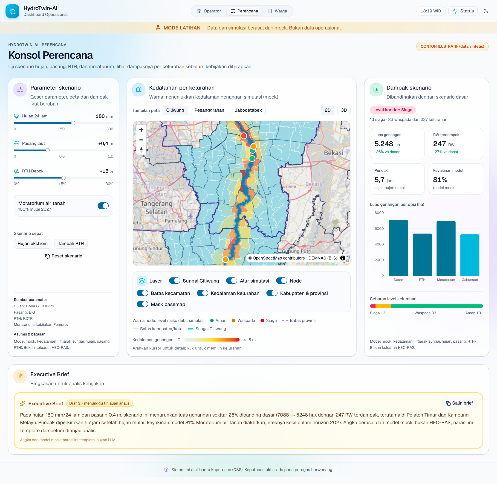
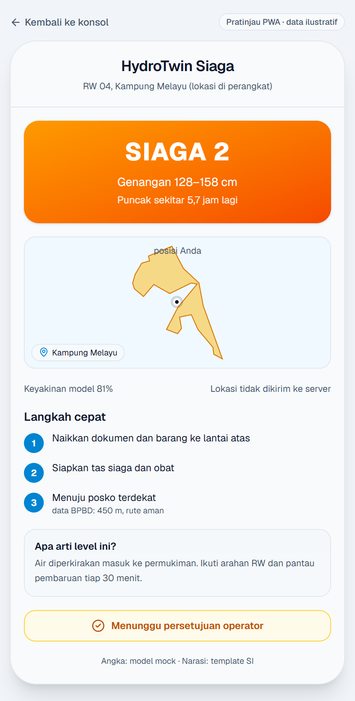
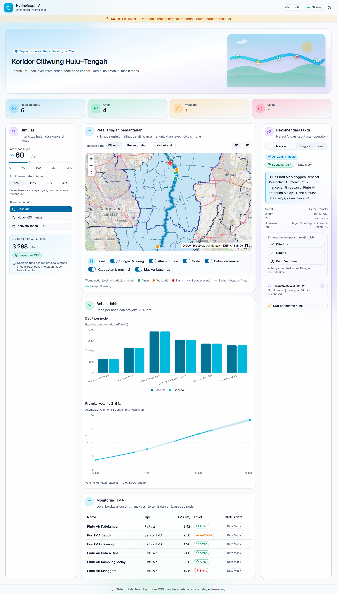

# HydroTwin-AI

Super Intelligence (SI) untuk pemantauan, prediksi limpasan mikro, dan skenario mitigasi banjir Jakarta: model SI mengklasifikasi dan menarasikan, model numerik menghitung, operator memutuskan.

Prototipe memiliki tiga tampilan: **Konsol Perencana** (`/rencana`), **Dashboard Operasional** (`/ops`), dan **PWA Warga** (`/warga`).

> **Semua data pada prototipe adalah mock.** Sistem ini alat bantu keputusan (DSS); keputusan akhir ada pada petugas berwenang.

## Tampilan Utama — Konsol Perencana



Perencana menggeser hujan 24 jam, pasang laut, RTH Depok, dan moratorium air tanah; peta menampilkan heatmap kedalaman per kelurahan, panel dampak menghitung luas genangan dan RW terdampak, lalu Executive Brief merangkumnya untuk analis.

## Tiga Tampilan

| Rute | Tampilan | Untuk siapa |
|---|---|---|
| `/rencana` | Konsol Perencana | Perencana Pemprov DKI, Kota Depok, Kabupaten Bogor |
| `/ops` | Dashboard Operasional | Operator BPBD dan DSDA |
| `/warga` | PWA Warga | Warga RW bantaran |

### PWA Warga



Level siaga, kisaran kedalaman, puncak, peta kelurahan dengan posisi di perangkat, langkah evakuasi, dan status persetujuan operator.

### Dashboard Operasional



Monitoring TMA, simulasi debit, peta 2D/3D, rekomendasi taktis, keputusan operator, log audit, dan draf peringatan publik.

## Fitur

**Konsol Perencana**

- Parameter skenario: hujan 24 jam (0–300 mm), pasang laut (0–1,2 m), RTH Depok (0–30%), moratorium air tanah.
- Heatmap kedalaman 237 kelurahan koridor Ciliwung, warna dari kedalaman simulasi; hover dan klik untuk detail.
- Dampak skenario: luas genangan, RW terdampak, waktu puncak, keyakinan model, grafik empat opsi kebijakan.
- Executive Brief: draf narasi untuk analis, dengan angka dari model dan catatan mock.
- Detail pintu air tetap tersedia lewat klik node di peta.

**Dashboard Operasional**

- Peta interaktif 2D/3D: centerline Ciliwung, alur simulasi, node berwarna level risiko, batas kecamatan/kabupaten/provinsi.
- Simulasi Rational Method (mock) dengan routing DAG, proyeksi 3–6 jam, dan skor kepastian.
- Rekomendasi dari adapter LLM (mock) dengan fallback rule-based, timeout 5 detik, dan validasi angka.
- Keputusan operator dan log audit; draf peringatan publik tanpa pengiriman otomatis.

**PWA Warga**

- Kartu peringatan mobile dengan level, kedalaman, waktu puncak, dan tiga langkah evakuasi.
- Posisi GPS diproses di perangkat, tidak dikirim ke server.
- Status "Disetujui operator BPBD" muncul setelah ada keputusan operator yang diterima.

## Menjalankan Prototipe

Prasyarat: Node.js 22+, pnpm 9+.

```bash
cd apps/dashboard
cp .env.example .env.local
pnpm install
pnpm dev
```

Buka salah satu rute:

- `http://localhost:5173/rencana` — Konsol Perencana
- `http://localhost:5173/ops` — Dashboard Operasional
- `http://localhost:5173/warga` — PWA Warga

Perintah lain:

```bash
pnpm lint
pnpm typecheck
pnpm test
pnpm build
```

## Struktur Repositori

```
apps/dashboard/        Prototipe React (Vite, Tailwind, shadcn/ui, MapLibre, Recharts)
  public/geo/          GeoJSON: kelurahan, kecamatan, kabupaten, provinsi, Ciliwung, alur
  public/terrain/      Tile terrain-RGB dari DEMNAS
  src/engine/          Simulasi debit dan model kedalaman perencana (mock)
  src/features/        Map, simulasi, rekomendasi, planner, monitoring
  src/pages/           OpsDashboardPage, PlannerPage, WargaPage
  scripts/             Skrip pembangunan data dan screenshot
docs/                  Artefak analisis, arsitektur, dan UI
  analysis/            Requirement, use case, user story, DFD, state, ERD
  architecture/        C4, SPBE 6 domain, deployment, sequence, ADR
  diagrams/            Diagram .drawio
  ui-prototype/        Wireframe, design token, interaksi, screenshot
data/                  Data sumber lokal (SHP, DEMNAS) — tidak masuk repo
```

## Data

| Data | Sumber | Status |
|---|---|---|
| Batas kelurahan (237) | BPS ADM4 2020, dipotong ke koridor | Open data |
| Batas kecamatan/kabupaten/provinsi | Peta Kita (SHP) | Open data |
| Elevasi | DEMNAS (BIG) | Open data |
| Centerline Ciliwung & Pesanggrahan | OpenStreetMap (ODbL) | Open data |
| TMA, hujan, tutupan lahan, debit, kedalaman | Generator internal | Mock/sintetis |

Bangun ulang poligon kelurahan:

```bash
python scripts/build-kelurahan-geo.py
```

Catatan:

- Koordinat pintu air hasil snap ke centerline OSM dan **belum diverifikasi DSDA**.
- Jumlah RW per kelurahan masih perkiraan dari luas, bukan data RW resmi.
- Basemap OSM memerlukan internet.
- Data sumber berukuran besar berada di `data/` dan diabaikan git.

## Batasan Prototipe

- Model kedalaman perencana masih mock (`engine/planner.ts`), bukan HEC-RAS/GNN.
- PWA warga belum memakai service worker atau cache offline.
- Status persetujuan membaca log keputusan operator di store, belum snapshot publik.
- Dashboard operasional dan konsol perencana memakai store simulasi terpisah agar satuan mm/jam dan mm/24 jam tidak saling mengganggu.

## Dokumentasi

- [Dokumentasi lengkap](docs/README.md)
- [UI prototipe & screenshot](docs/ui-prototype/README.md)
- [Arsitektur SPBE 6 domain](docs/architecture/06-arsitektur-spbe.md)
- [Rencana pengembangan](docs/plan/README.md)
- [Requirement](docs/analysis/requirements.md)

## Tim

HydroAI Labs — Argo Nurcahyo, Yovi Maulana Nugraha, Jhonathan Putro Siahaan, Eka Miftakhul Rachmawati, Meidiana Rahmawati.
