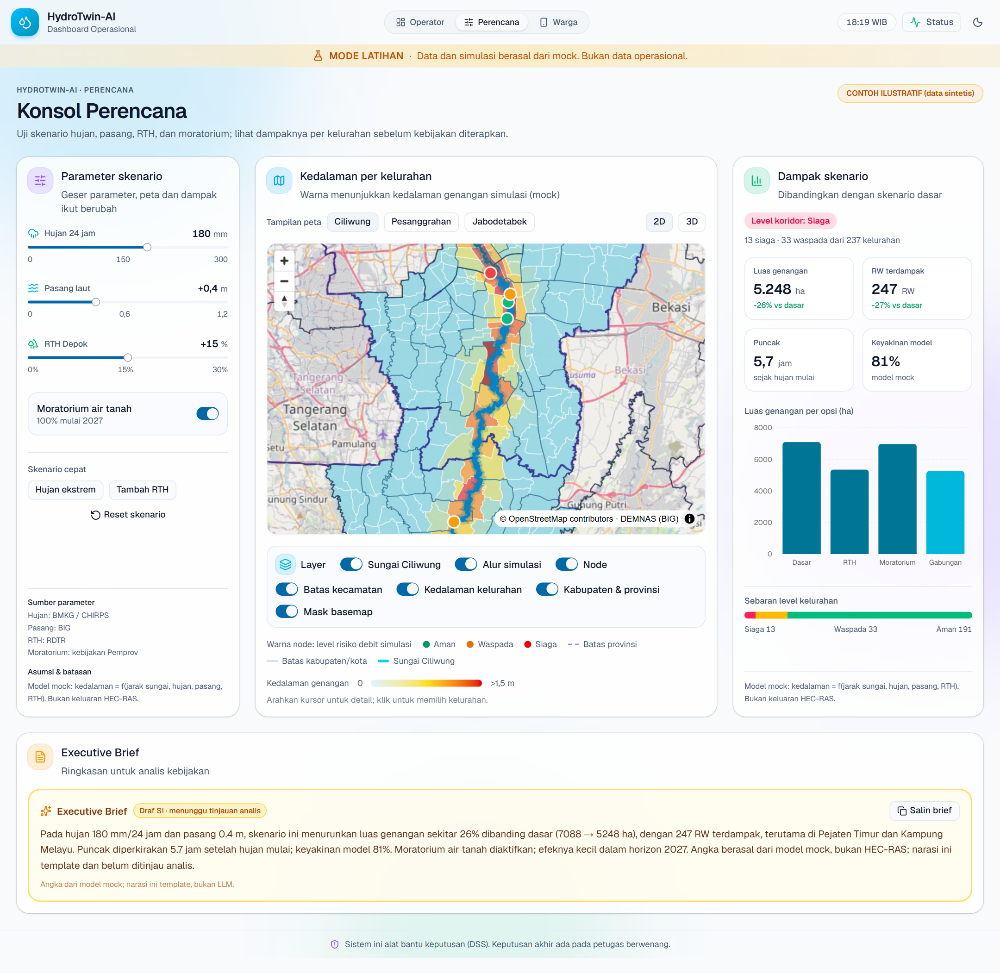
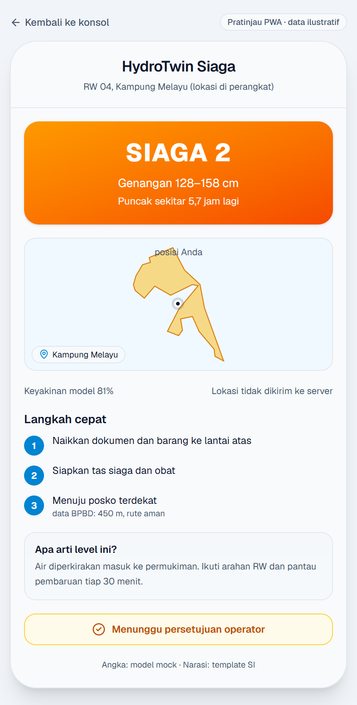
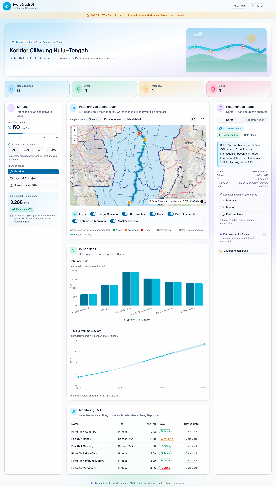

# HydroTwin-AI · Prototipe Frontend

Prototipe frontend HydroTwin-AI dengan tiga tampilan:

| Rute | Tampilan | Isi |
|---|---|---|
| `/ops` | Dashboard Operasional | Monitoring TMA, simulasi debit, peta 2D/3D, rekomendasi, keputusan operator, log audit |
| `/rencana` | Konsol Perencana | Parameter skenario, heatmap kedalaman per kelurahan, dampak skenario, Executive Brief |
| `/warga` | PWA Warga | Kartu peringatan mobile: level siaga, kedalaman, langkah evakuasi, status persetujuan |

Data dan simulasi masih mock (mode latihan). Semua angka diberi label mock atau ilustratif.

Dokumen acuan ada di `docs/` (requirements, ui-prototype, architecture).

## Menjalankan

```bash
cp .env.example .env.local
pnpm install
pnpm dev
```

## Skrip

| Perintah            | Fungsi                                    |
| ------------------- | ----------------------------------------- |
| `pnpm dev`          | Server pengembangan                       |
| `pnpm build`        | Typecheck lalu build produksi             |
| `pnpm lint`         | oxlint                                    |
| `pnpm typecheck`    | `tsc -b`                                  |
| `pnpm test`         | Vitest                                    |
| `pnpm format`       | Prettier (termasuk urutan class Tailwind) |
| `pnpm format:check` | Cek format tanpa mengubah file            |

## Stack

React 19, Vite, TypeScript (strict), Tailwind CSS v4, shadcn/ui (radix, warna slate), MapLibre GL JS, Recharts, Zustand, TanStack Query, oxlint, Prettier.

## Data kelurahan

`public/geo/kelurahan-koridor.geojson` berisi 237 kelurahan dari empat kota/kabupaten koridor (Jakarta Selatan, Jakarta Timur, Jakarta Pusat, Kota Depok), dipotong dari SHP BPS 2020. Bangun ulang dengan:

```bash
python scripts/build-kelurahan-geo.py
```

Properti: `kelurahan`, `kecamatan`, `kota`, `luasHa`, `jarakSungaiM`, dan `rw` (perkiraan mock).

## Status fase

- [x] P0 Setup
- [x] P1 Shell & data mock
- [x] P2 Peta
- [x] P3 Simulasi & grafik
- [x] P4 Rekomendasi & keputusan
- [x] P5 Draf & status
- [x] P6 Konsol perencana & heatmap kelurahan
- [x] P7 PWA warga
- [ ] P8 Kualitas (E2E, a11y, performa)

## Tangkapan layar







Galeri lengkap dan penjelasan per komponen ada di `docs/ui-prototype/README.md`.
