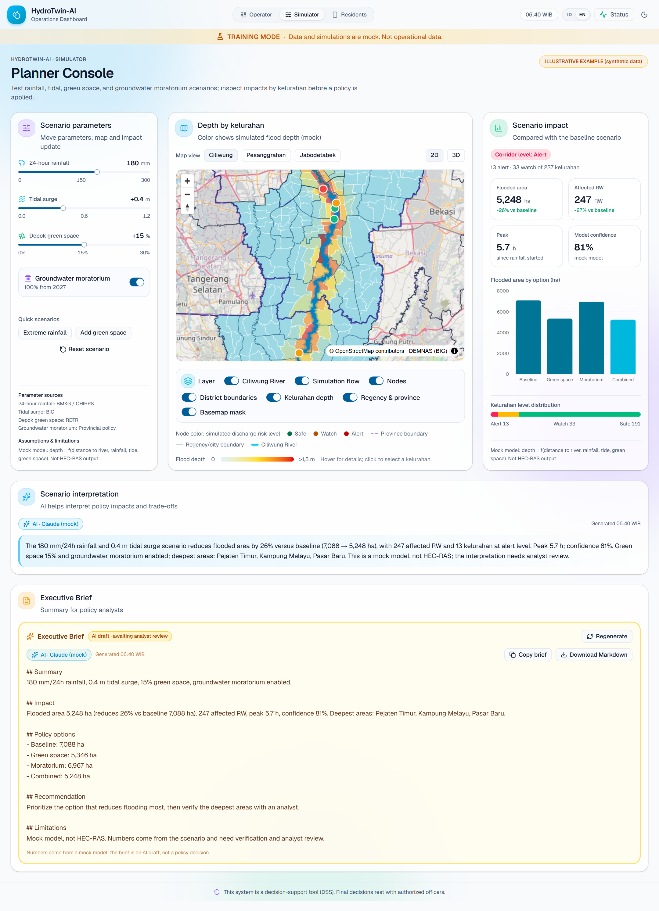

# Dokumentasi HydroTwin-AI

Dokumentasi untuk prototipe HydroTwin-AI dengan dua use case: **Early Warning System** (Dashboard Operasional + PWA Warga) dan **Simulator** (Konsol Perencana). Status: **v0.5**, F0–F6 selesai 19 November 2026. UI default English dengan pilihan Bahasa Indonesia.

Pemilik: Tim SWE (Argo Nurcahyo, Yovi Maulana Nugraha). Tim AI (Jhonathan Putro Siahaan, Eka Miftakhul Rachmawati, Meidiana Rahmawati) memberi masukan untuk data, simulasi, dan LLM.

## Peta Dokumen

### Analisis (`analysis/`)

| Dokumen | Isi |
|---|---|
| `requirements.md` | Requirement fungsional (FR) dan non-fungsional (NFR) |
| `use-cases.md` | Aktor, diagram dua use case (EWS + Simulator), spesifikasi UC-01–UC-16 dan UC-20–UC-23 |
| `user-stories.md` | Epic, 28 user story, dan kriteria penerimaan |
| `traceability.md` | Keterkaitan requirement, use case, story, layar, dan komponen |
| `dfd.md` | Data flow diagram level 0 dan 1 untuk EWS dan Simulator |
| `activity.md` | Alur kerja EWS (operator + warga) dan Simulator |
| `state.md` | Status rekomendasi, peringatan publik, sumber narasi, level risiko, layanan, mode, brief |
| `data-model.md` | ERD dan kamus data, termasuk peringatan per wilayah dan skenario kebijakan |
| `risks.md` | Risiko, asumsi, dan isu terbuka |
| `glossary.md` | Istilah dan singkatan |
| `responsible-ai-review.md` | Checklist Responsible AI |

### Arsitektur (`architecture/`)

| Dokumen | Isi |
|---|---|
| `01-context.md` | C4 level 1, konteks sistem |
| `02-container.md` | C4 level 2, kontainer dan protokol |
| `03-component-frontend.md` | C4 level 3, komponen frontend dan kontrak layanan |
| `04-deployment.md` | Deployment prototipe, staging, dan produksi |
| `05-arsitektur-si.md` | Tiga lapisan SI, status komponen, pipeline pemodelan |
| `06-arsitektur-spbe.md` | Arsitektur SPBE 6 domain untuk HydroTwin-AI |
| `sequence.md` | Sequence diagram: slider, narasi & fallback, keputusan, siarkan/tarik peringatan, simulator |
| `adr/ADR-001` sampai `ADR-006` | Keputusan arsitektur |

### UI Prototipe (`ui-prototype/`)

| Dokumen | Isi |
|---|---|
| `README.md` | Site map dan prinsip prototipe |
| `screen-inventory.md` | Daftar layar EWS (O-01–O-08, W-01–W-02) dan Simulator (P-01–P-04) |
| `wireframes.md` | Struktur layar (low fidelity), termasuk O-06, W-01, P-01, P-04 |
| `design-tokens.md` | Warna, tipografi, spacing, peta |
| `interaction-spec.md` | Perilaku setiap kontrol, termasuk siarkan/tarik dan simulator |
| `demo-script.md` | Skrip demo 7–8 menit untuk EWS dan Simulator |
| `a11y-checklist.md` | Checklist aksesibilitas WCAG 2.1 AA |
| `usability-notes.md` | Template uji pengguna |
| `screenshots/` | Tangkapan layar prototipe (12 gambar) |
| `hydrotwin/` | Mockup HydroTwin-AI: konsol perencana + PWA, sumber HTML dan PNG |

## Urutan Membaca

1. `analysis/requirements.md`
2. `analysis/use-cases.md`
3. `architecture/01-context.md`
4. `architecture/02-container.md`
5. `ui-prototype/README.md`
6. Sisanya sesuai kebutuhan

### Rencana (`plan/`)

| Dokumen | Isi |
|---|---|
| `plan/README.md` | Indeks rencana dan cara pakai |
| `plan/ews-simulator.md` | Rencana induk dua use case: EWS dan Simulator, fase F0–F5 |
| `plan/web-publik.md` | Perluasan halaman masyarakat: peringatan per wilayah, data desa, zonasi, offline (Q0–Q7) |
| `plan/dashboard.md` | Status dashboard P0–P5 dan sisa pekerjaan P6 |

### Diagram Editable (`diagrams/`)
File `.drawio` dapat dibuka di [diagrams.net](https://app.diagrams.net) atau ekstensi VS Code "Draw.io Integration".

> **Catatan revisi 18 November 2026:** diagram `.drawio` di bawah masih memuat satu use case dashboard. Acuan terkini adalah diagram Mermaid di `analysis/` dan `architecture/`; pembaruan `.drawio` dikerjakan pada fase F5.

| File | Diagram |
|---|---|
| `01-context.drawio` | Context (C4 L1) |
| `02-container.drawio` | Container (C4 L2) |
| `03-component-frontend.drawio` | Component frontend (C4 L3) |
| `04-deployment-produksi.drawio` | Deployment produksi |
| `05-dfd-level-0.drawio` | DFD level 0 |
| `06-dfd-level-1.drawio` | DFD level 1 |
| `07-use-case.drawio` | Use case (versi lama, satu use case dashboard) |
| `08-activity.drawio` | Activity (versi lama, alur operator) |

Sequence, state, dan ERD tersedia dalam Mermaid di `analysis/` dan `architecture/`. Mulai revisi 18 November 2026, Mermaid menjadi acuan utama; `.drawio` diperbarui pada F5.

## Konvensi

- Diagram ditulis dalam Mermaid dan dapat dirender langsung di GitHub.
- ID requirement mengikuti `analysis/requirements.md`. Jangan mengubah ID yang sudah dipakai di traceability.
- Data demo selalu diberi label mock atau sintetis.
- Bahasa dokumen Indonesia. Istilah teknis tetap Inggris bila lazim.

## Belum Ada (Tahap Berikutnya)

- Kontrak API (`api-contract.md`)
- Hasil uji usability
- Provider AI produksi untuk peringatan, interpretasi, dan brief (masih mock)
- Autentikasi/RBAC dan kanal distribusi peringatan produksi
- Peta zonasi desa, GPS, dan offline penuh (rencana `plan/web-publik.md`)
- Uji keyboard, screen reader, dan buta warna manual yang menyeluruh
