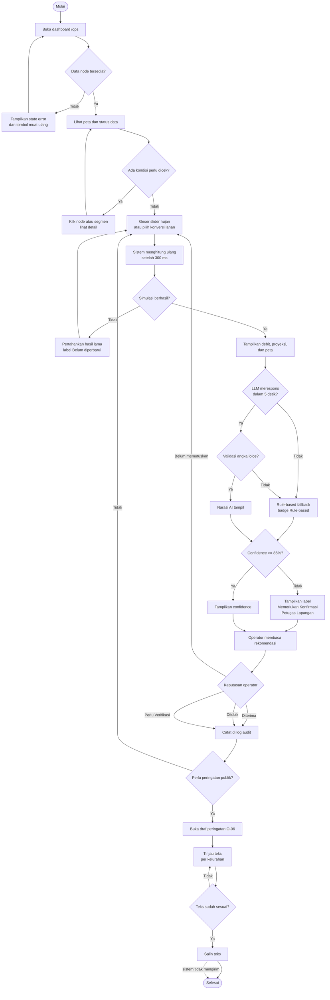

# Activity Diagram — Alur Kerja Operator

Alur utama dari membuka dashboard sampai menyalin draf peringatan.

## Catatan

- Operator dapat kembali ke simulasi kapan saja. Keputusan lama tetap tercatat di log.
- Jalur fallback (M) selalu tersedia. Operator tidak pernah menerima layar kosong saat LLM gagal.
- Penyalinan teks adalah satu-satunya bentuk "distribusi" pada prototipe.
