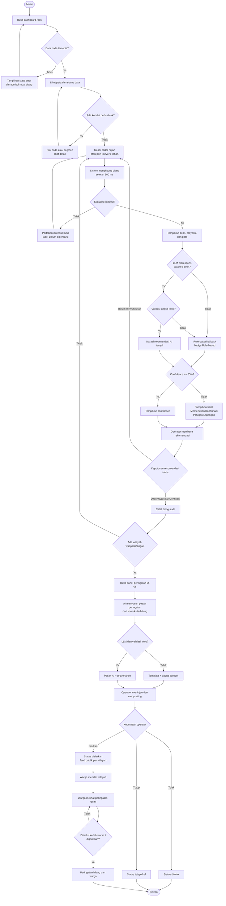
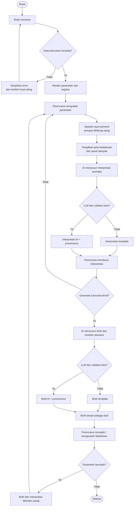

# Activity Diagram — Alur EWS & Simulator

## 1. Alur EWS — Operator dan Warga

Alur utama dari membuka dashboard operator sampai warga menerima peringatan.

## 2. Alur Simulator — Perencana

## Catatan

- Operator dapat kembali ke simulasi kapan saja. Keputusan dan peringatan lama tetap tercatat di log.
- Jalur fallback selalu tersedia; operator tidak pernah menerima layar kosong saat LLM gagal.
- Peringatan publik tidak pernah berasal langsung dari simulasi. Hanya peringatan yang disiarkan operator yang dapat dibaca warga (FR-34, FR-R10).
- Menyunting pesan tidak menimpa teks AI asli. Keduanya disimpan untuk audit (FR-R9).
