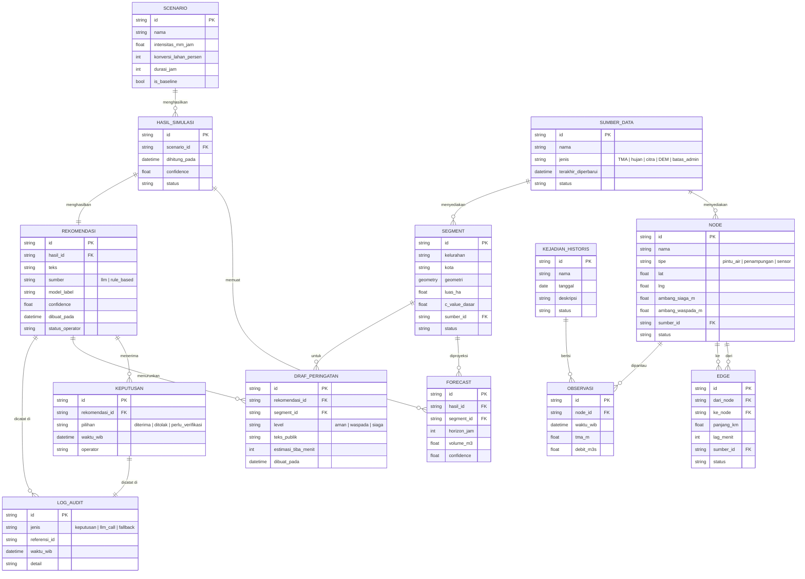

# Model Data (ERD)

Model logis untuk dashboard. Semua entitas memiliki `sumber` dan `status` (`open_data`, `sintetis`, `mock`) sesuai FR-28.

## Catatan

- `SCENARIO.is_baseline` menandai skenario acuan untuk FR-10.
- `REKOMENDASI.status_operator` disalin dari `KEPUTUSAN` terakhir untuk tampilan cepat. Sumber kebenaran tetap di `KEPUTUSAN`.
- `LOG_AUDIT` bersifat append-only. Entri tidak boleh diubah atau dihapus (NFR-11).
- Pada prototipe, semua entitas berasal dari JSON/GeoJSON mock dan divalidasi dengan Zod. Tidak ada tabel database.
- Tipe `geometry` mengacu pada GeoJSON; implementasi backend akan memakai PostGIS.
