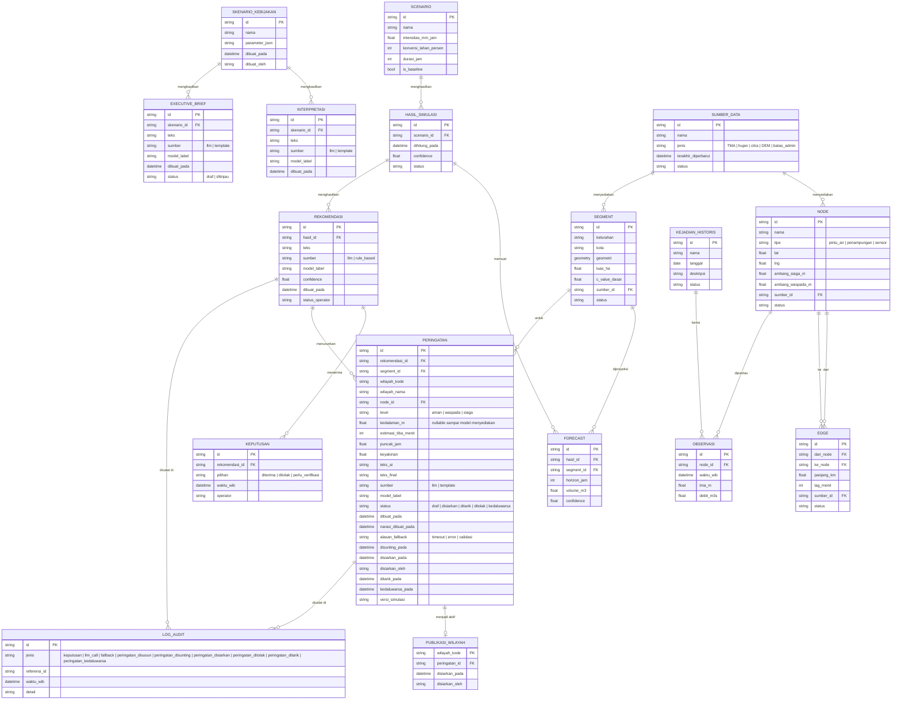

# Model Data (ERD)

Model logis untuk dua use case: **Early Warning System (EWS)** dan **Simulator**. Entitas data geospasial dan observasi memiliki `sumber` dan `status` (`open_data`, `sintetis`, `mock`) sesuai FR-28; entitas keputusan dan peringatan memiliki status alur sendiri.

## Catatan

- `SCENARIO` adalah skenario simulasi operator EWS. `SKENARIO_KEBIJAKAN` adalah skenario simulator perencana.
- `parameter_json` pada `SKENARIO_KEBIJAKAN` mengikuti registry parameter (FR-39); kunci dan batasnya divalidasi sebelum disimpan.
- `REKOMENDASI.status_operator` disalin dari `KEPUTUSAN` terakhir untuk tampilan cepat. Sumber kebenaran tetap di `KEPUTUSAN`.
- `PERINGATAN.status` adalah sumber kebenaran publikasi. `PUBLIKASI_WILAYAH` menyimpan pointer peringatan aktif per wilayah; satu wilayah hanya boleh punya satu baris.
- `PERINGATAN.teks_ai` tidak boleh ditimpa saat operator menyunting; teks final disimpan di `teks_final` (FR-R9).
- Peringatan berstatus `disiarkan` adalah satu-satunya yang boleh dibaca halaman warga (FR-34, FR-R10).
- `LOG_AUDIT` bersifat append-only. Entri tidak boleh diubah atau dihapus (NFR-11).
- Pada prototipe, semua entitas berasal dari JSON/GeoJSON mock dan divalidasi dengan Zod. Tidak ada tabel database.
- Tipe `geometry` mengacu pada GeoJSON; implementasi backend akan memakai PostGIS.
