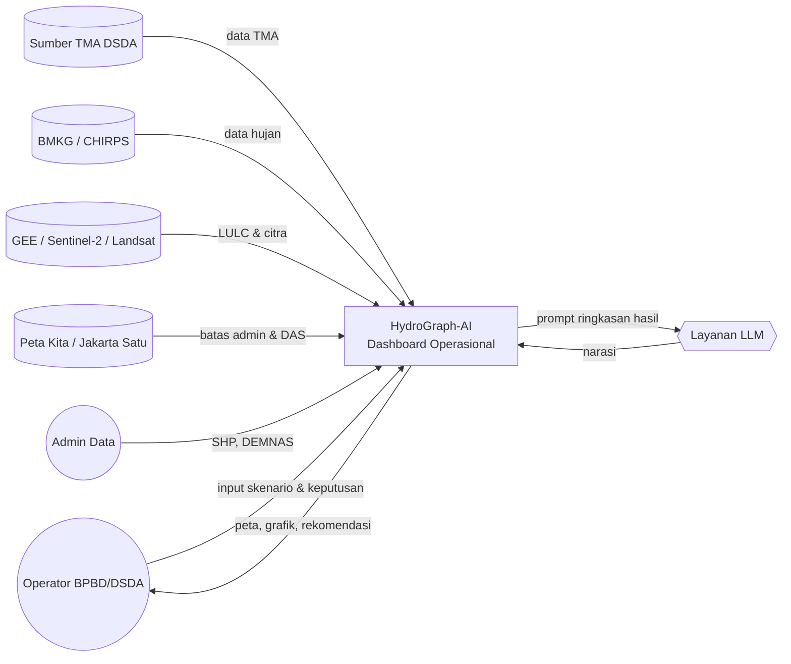
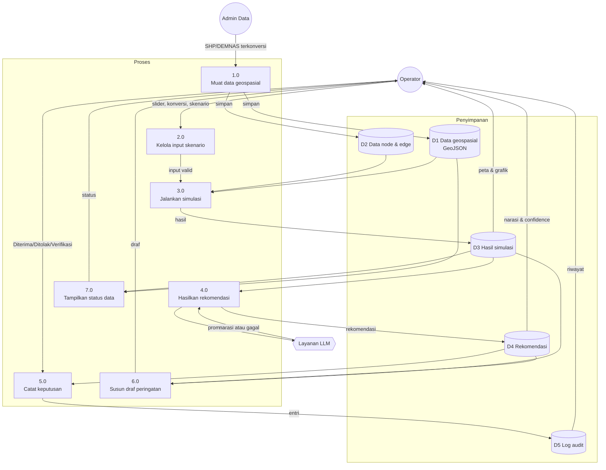

# Data Flow Diagram — HydroGraph-AI (Dashboard)

Lingkup: dashboard dan batas dengan data serta layanan di sekitarnya. Pemodelan hidrologi di dalam "Sistem Simulasi" diperlakukan sebagai kotak hitam dengan kontrak tetap.

## 1. DFD Level 0 (Context)

## 2. DFD Level 1

## 3. Kamus Data

| ID | Nama | Isi | Pemilik |
|---|---|---|---|
| D1 | Data geospasial | Kelurahan, DAS, jaringan sungai (GeoJSON WGS84) | Tim AI |
| D2 | Data node & edge | Pintu air, sensor, segmen, lag, ambang TMA | Tim AI |
| D3 | Hasil simulasi | Debit per node & segmen, proyeksi 3–6 jam, confidence | Sistem Simulasi |
| D4 | Rekomendasi | Teks, sumber, confidence, waktu generasi, status | Tim SWE |
| D5 | Log audit | ID rekomendasi, keputusan, waktu WIB, sumber | Tim SWE |

## 4. Aturan Aliran

- Operator tidak berinteraksi langsung dengan D1 atau D2. Semua akses melalui proses.
- Prompt ke LLM hanya berisi ringkasan hasil simulasi, tidak berisi data pribadi.
- Tidak ada aliran dari proses 5.0 ke sistem fisik. Keputusan hanya berhenti di D5 (FR-R1).
- Jika LLM gagal, proses 4.0 menghasilkan rekomendasi rule-based dan menandai sumbernya (FR-R3).
