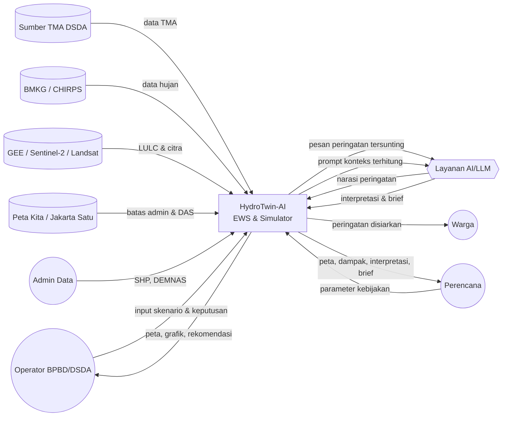
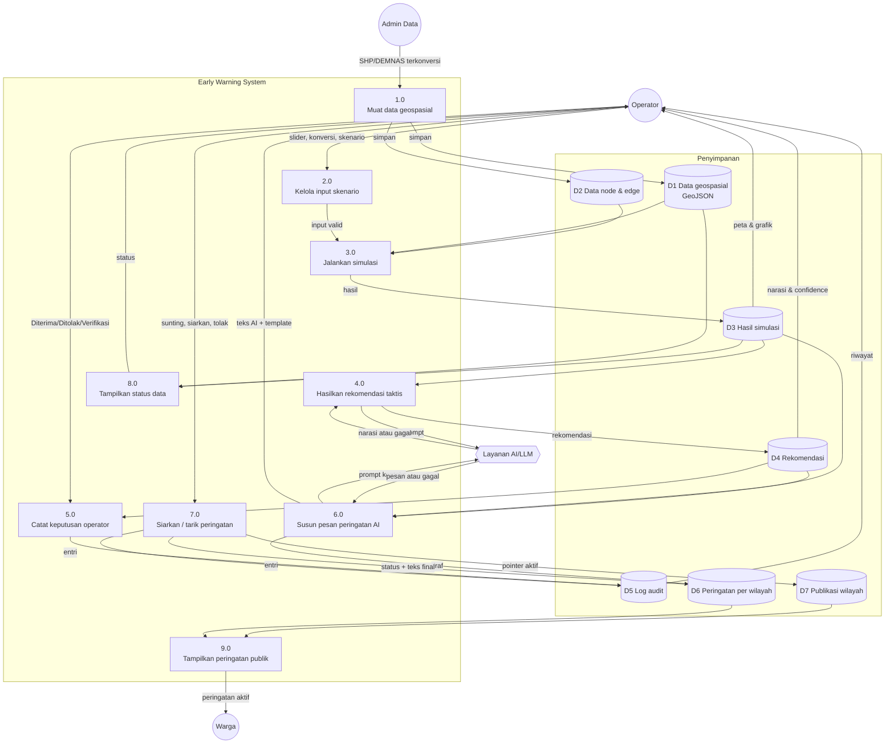
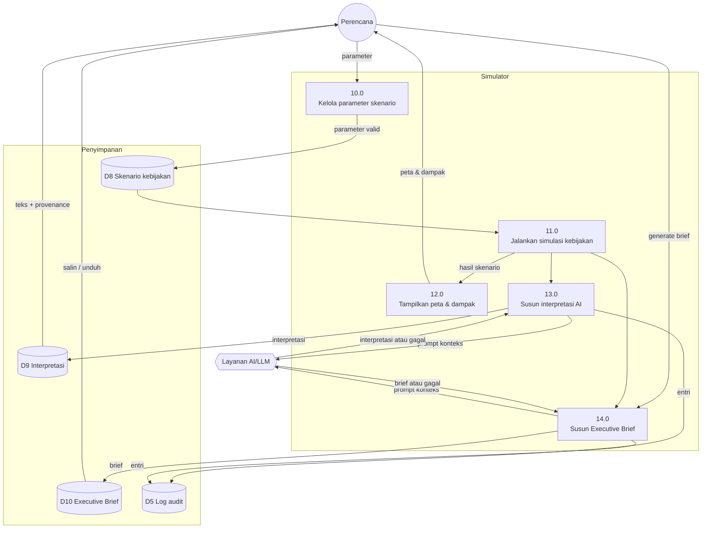

# Data Flow Diagram — HydroTwin-AI (EWS & Simulator)

Lingkup: dua use case, **Early Warning System (EWS)** dan **Simulator**, beserta batas dengan data serta layanan di sekitarnya. Pemodelan hidrologi di dalam "Sistem Simulasi" diperlakukan sebagai kotak hitam dengan kontrak tetap.

## 1. DFD Level 0 (Context)

## 2. DFD Level 1 — EWS

## 3. DFD Level 1 — Simulator

## 4. Kamus Data

| ID | Nama | Isi | Pemilik |
|---|---|---|---|
| D1 | Data geospasial | Kelurahan, DAS, jaringan sungai (GeoJSON WGS84) | Tim AI |
| D2 | Data node & edge | Pintu air, sensor, segmen, lag, ambang TMA | Tim AI |
| D3 | Hasil simulasi | Debit per node & segmen, proyeksi 3–6 jam, confidence | Sistem Simulasi |
| D4 | Rekomendasi taktis | Teks, sumber, confidence, waktu generasi, status | Tim SWE |
| D5 | Log audit | Keputusan, perubahan peringatan, pemanggilan LLM, fallback | Tim SWE |
| D6 | Peringatan per wilayah | Teks AI, teks final, level, status, operator, waktu | Tim SWE |
| D7 | Publikasi wilayah | Pointer peringatan aktif per wilayah | Tim SWE |
| D8 | Skenario kebijakan | Parameter registry, nilai, waktu | Tim SWE |
| D9 | Interpretasi | Teks interpretasi, sumber, model, waktu | Tim SWE |
| D10 | Executive Brief | Teks brief, sumber, model, status | Tim SWE |

## 5. Aturan Aliran

- Operator tidak berinteraksi langsung dengan D1 atau D2. Semua akses melalui proses.
- Prompt ke LLM hanya berisi konteks hasil yang sudah dihitung, tidak berisi data pribadi atau data mentah.
- Tidak ada aliran dari proses keputusan ke sistem fisik. Keputusan hanya berhenti di D5 (FR-R1).
- Tidak ada aliran langsung dari D3 ke warga. Warga hanya membaca D7/D6 yang sudah disiarkan operator (FR-34, FR-R10).
- Jika LLM gagal, proses 4.0, 6.0, 13.0, dan 14.0 menghasilkan keluaran template dan menandai sumbernya (FR-R3).
- AI tidak menentukan level risiko; level berasal dari D3 (FR-R8).
