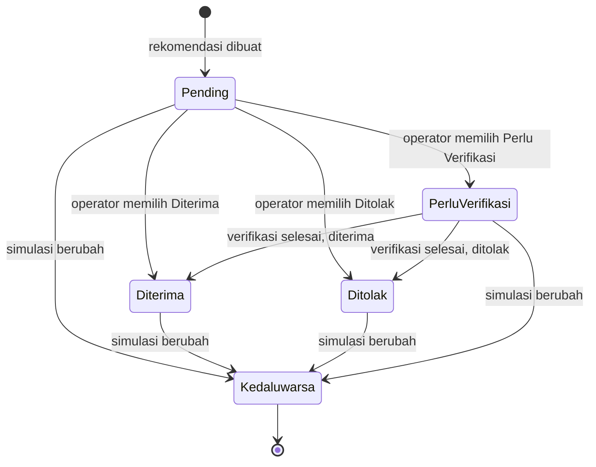
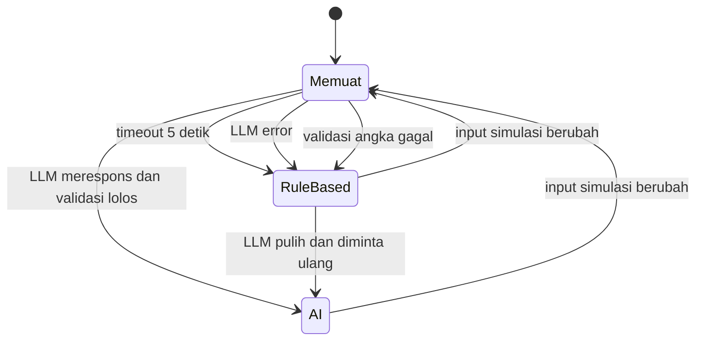
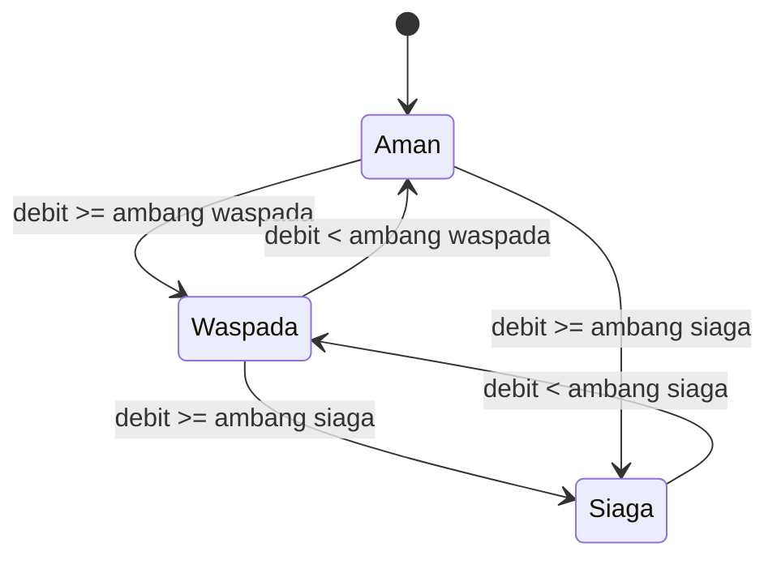
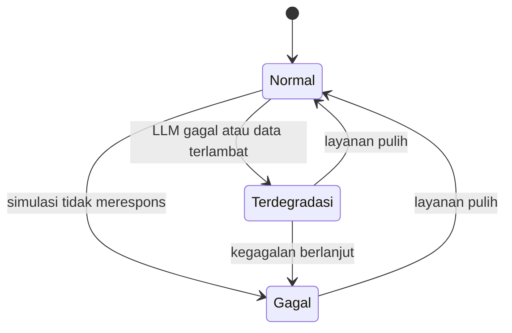
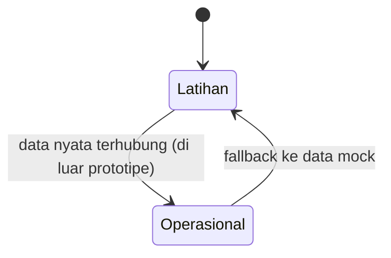

# State Diagram

## 1. Status Rekomendasi (Operator)

Status keputusan operator untuk satu rekomendasi.

Catatan:
- Status `Kedaluwarsa` dipicu saat input simulasi berubah dan rekomendasi baru dibuat. Riwayat tetap ada di log audit.
- Keputusan hanya mengubah status. Tidak ada efek ke node atau pompa (FR-R1).

## 2. Status Sumber Narasi

## 3. Level Risiko per Node/Segmen

Catatan: transisi berbasis ambang dengan histeresis (margin 5%) agar warna tidak berkedip saat nilai berada di batas.

## 4. Status Layanan

## 5. Mode Dashboard

Pada prototipe, mode selalu `Latihan`.
