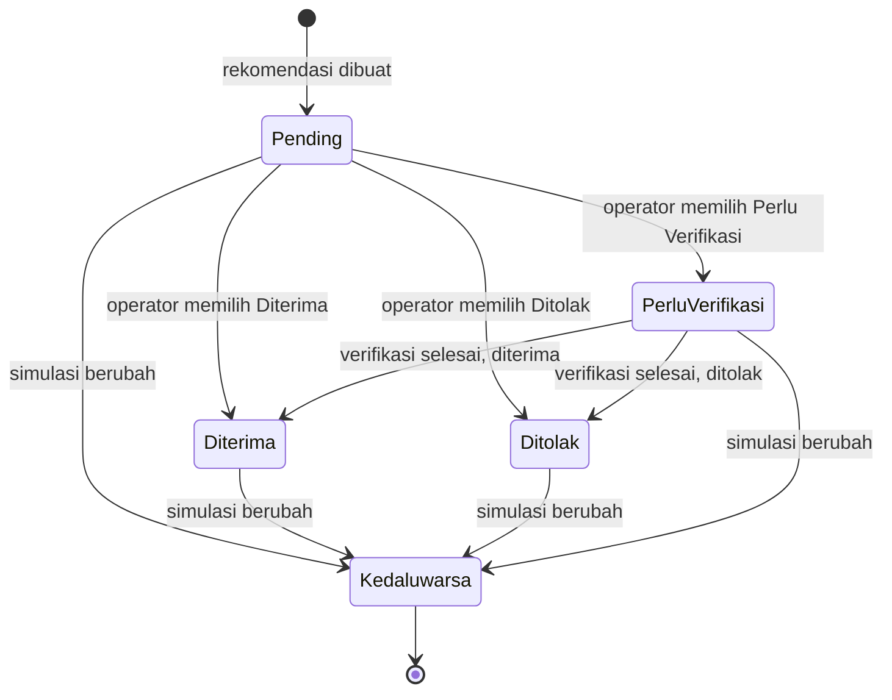
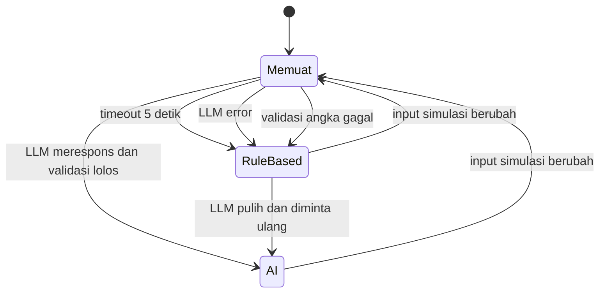
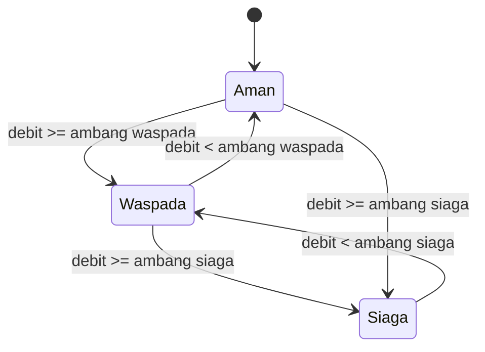
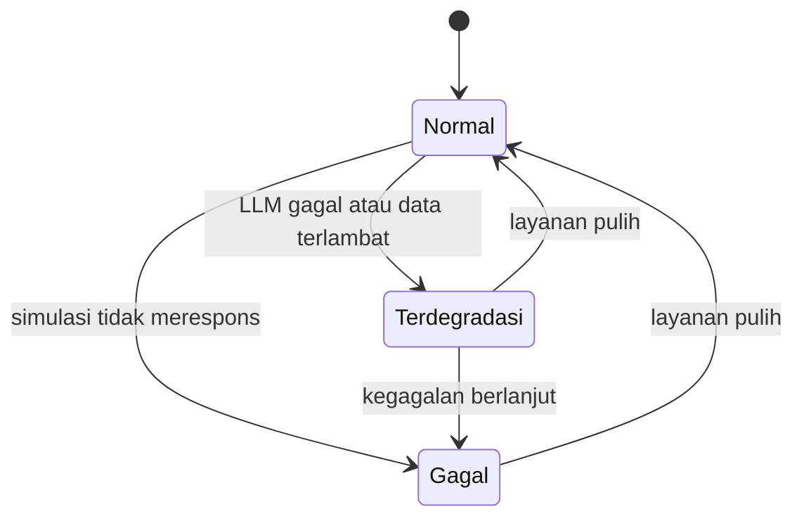
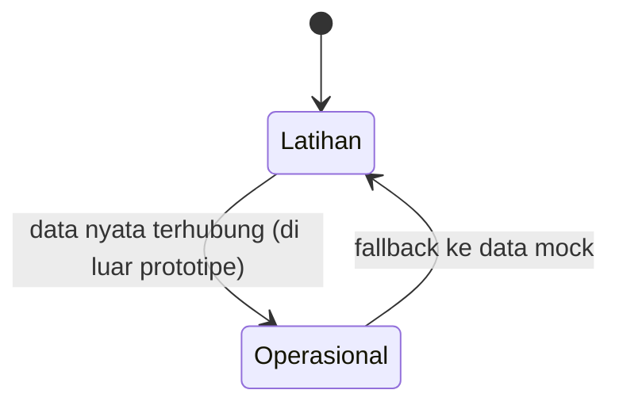
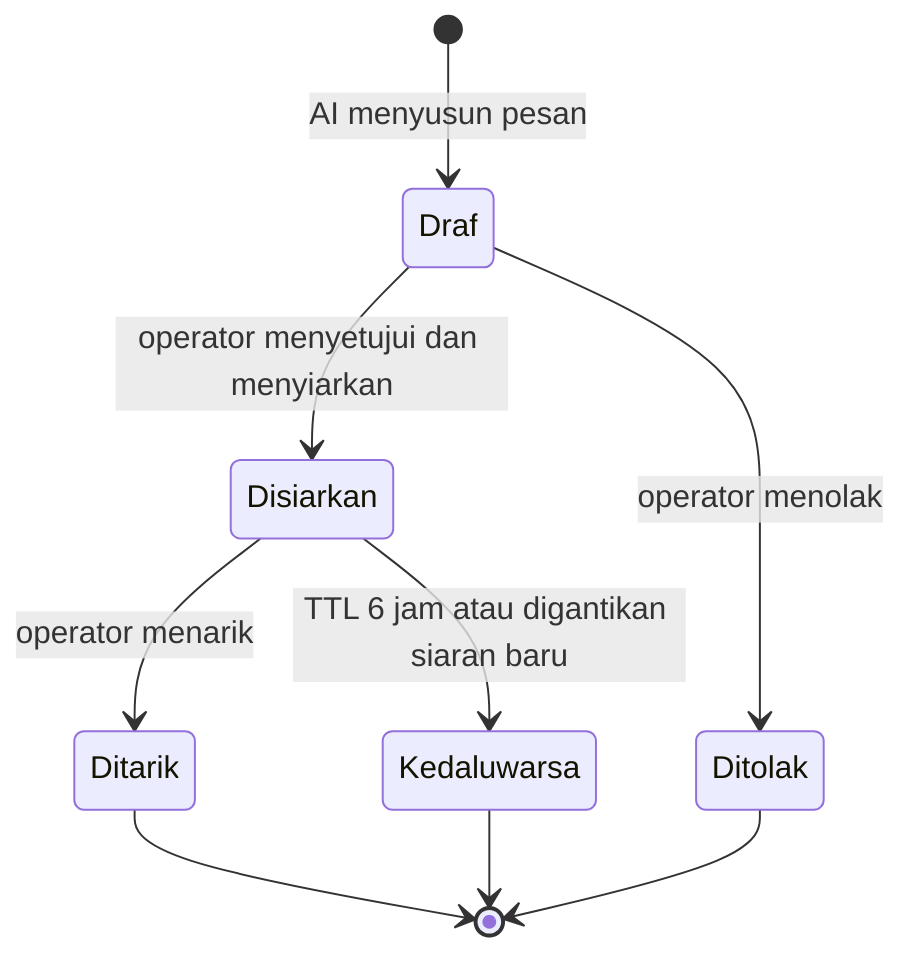
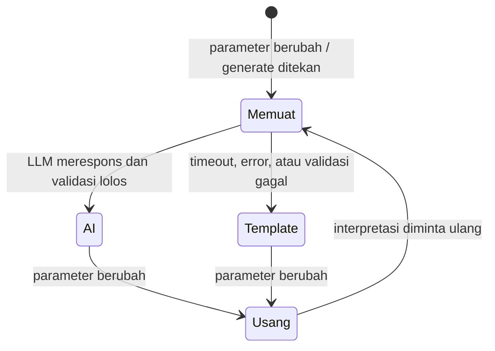

# State Diagram

## 1. Status Rekomendasi (Operator)

Status keputusan operator untuk satu rekomendasi.

Catatan:
- Status `Kedaluwarsa` dipicu saat input simulasi berubah dan rekomendasi baru dibuat. Riwayat tetap ada di log audit.
- Keputusan hanya mengubah status. Tidak ada efek ke node atau pompa (FR-R1).
- Status rekomendasi taktis **tidak** otomatis menjadi status peringatan publik. Persetujuan peringatan diatur di bagian 6.

## 2. Status Sumber Narasi

## 3. Level Risiko per Node/Segmen

Catatan: transisi berbasis ambang dengan histeresis (margin 5%) agar warna tidak berkedip saat nilai berada di batas.

## 4. Status Layanan

## 5. Mode Dashboard

Pada prototipe, mode selalu `Latihan`.

## 6. Status Peringatan Publik

Per wilayah, hanya satu peringatan yang boleh aktif.

Catatan:
- `Disiarkan` adalah satu-satunya status yang dapat dibaca halaman warga (FR-34, FR-R10).
- Teks AI asli (`teksAi`) dan teks final (`teksFinal`) disimpan terpisah; suntingan operator tercatat (FR-R9).
- Setiap transisi menambah entri log audit (FR-37).
- Peringatan wilayah A tidak boleh muncul di wilayah B (NFR-13).

## 7. Status Interpretasi & Executive Brief

Catatan:
- Interpretasi skenario diperbarui otomatis setelah input berhenti berubah; hasil usang dibatalkan.
- Executive Brief di-generate on-demand dan ditandai usang bila parameter berubah.
- Baik interpretasi maupun brief adalah draf AI, bukan keputusan kebijakan (FR-R11).
