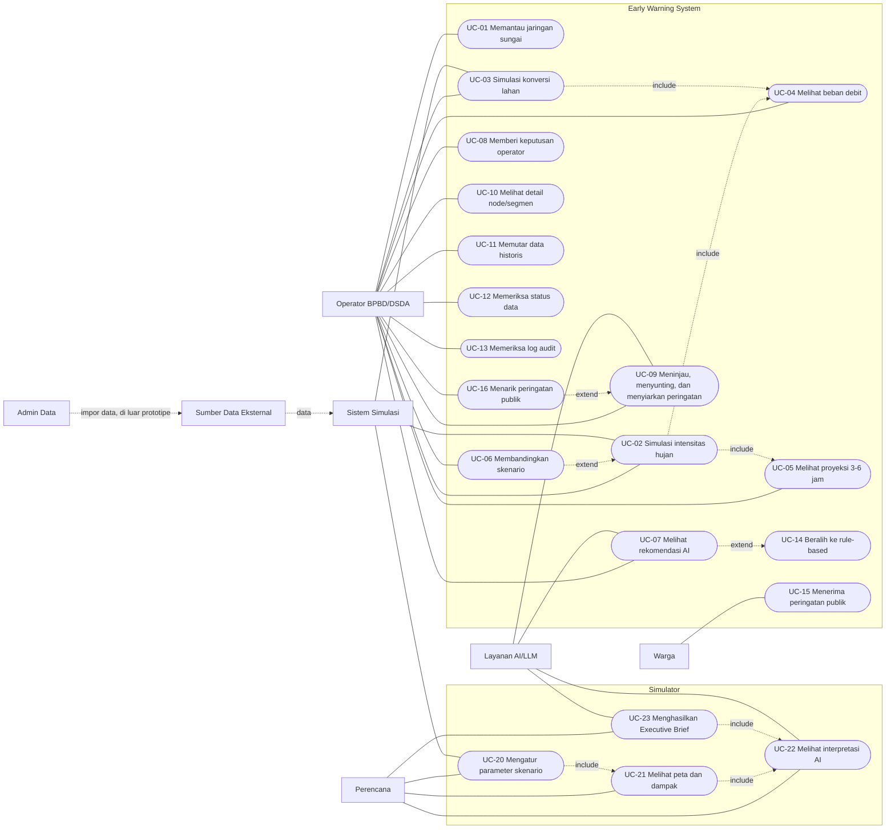

# Use Case — HydroTwin-AI (EWS & Simulator)

Lihat juga: `requirements.md`, `user-stories.md`, `traceability.md`.

HydroTwin-AI memiliki dua use case utama:

- **Early Warning System (EWS)** — operator memantau, menjalankan simulasi, meninjau pesan peringatan yang disusun AI, lalu menyiarkan atau menolak. Warga hanya menerima peringatan yang disiarkan.
- **Simulator** — perencana mengolah parameter kebijakan, melihat peta dan dampak, meminta interpretasi AI, dan menghasilkan Executive Brief.

## 1. Aktor

| Aktor | Tipe | Use case | Deskripsi |
|---|---|---|---|
| Operator BPBD/DSDA | Primer | EWS | Memantau kondisi sungai, menjalankan simulasi, meninjau peringatan, dan menyiarkan/menarik peringatan |
| Warga | Primer | EWS | Menerima peringatan resmi yang sudah disiarkan operator untuk wilayahnya |
| Perencana | Primer | Simulator | Mengatur parameter kebijakan, membaca dampak, dan menghasilkan Executive Brief |
| Admin Data | Primer (di luar prototipe) | Keduanya | Mengelola impor SHP, DEMNAS, dan data TMA |
| Sistem Simulasi | Sekunder | Keduanya | Menghitung debit, routing graf, proyeksi, kedalaman, dan confidence |
| Layanan AI/LLM | Sekunder | Keduanya | Menyusun pesan peringatan, interpretasi skenario, rekomendasi taktis, dan Executive Brief |
| Sumber Data Eksternal | Sekunder | Keduanya | TMA DSDA, BMKG/CHIRPS, GEE. Hanya relevan untuk arsitektur |

## 2. Diagram Use Case

Catatan: Mermaid belum mendukung diagram use case secara native. Diagram di bawah memakai `flowchart` dengan konvensi: aktor berbentuk kotak, use case berbentuk elips `([ ])`.

> Diagram `docs/diagrams/07-use-case.drawio` masih versi lama (satu use case dashboard). Diagram Mermaid di bawah adalah acuan terkini; `.drawio` diperbarui pada fase F5.

## 3. Daftar Use Case

| ID | Nama | Aktor utama | Use case | Requirement |
|---|---|---|---|---|
| UC-01 | Memantau jaringan sungai | Operator | EWS | FR-01, FR-02, FR-03, FR-06 |
| UC-02 | Simulasi intensitas hujan | Operator | EWS | FR-07, FR-11, FR-12 |
| UC-03 | Simulasi konversi lahan | Operator | EWS | FR-08, FR-11, FR-12 |
| UC-04 | Melihat beban debit per segmen | Operator | EWS | FR-13 |
| UC-05 | Melihat proyeksi volume 3–6 jam | Operator | EWS | FR-14, FR-22 |
| UC-06 | Membandingkan skenario | Operator | EWS | FR-09, FR-10 |
| UC-07 | Melihat rekomendasi taktis AI | Operator | EWS | FR-20, FR-21, FR-22, FR-23, FR-R4, FR-R5 |
| UC-08 | Memberi keputusan operator | Operator | EWS | FR-24, FR-25, FR-R1 |
| UC-09 | Meninjau, menyunting, dan menyiarkan peringatan | Operator | EWS | FR-26, FR-34, FR-37, FR-R6, FR-R9 |
| UC-10 | Melihat detail node/segmen | Operator | EWS | FR-05 |
| UC-11 | Memutar data historis banjir | Operator | EWS | FR-15 |
| UC-12 | Memeriksa status data & layanan | Operator | EWS | FR-28, FR-29, FR-30 |
| UC-13 | Memeriksa log audit | Operator | EWS | NFR-11 |
| UC-14 | Beralih ke rule-based fallback | Sistem (diperluas dari UC-07) | EWS | FR-21, FR-27, FR-R3 |
| UC-15 | Menerima peringatan publik | Warga | EWS | FR-34, FR-38, FR-R10 |
| UC-16 | Menarik peringatan publik | Operator | EWS | FR-35, FR-37 |
| UC-20 | Mengatur parameter skenario | Perencana | Simulator | FR-39, FR-40 |
| UC-21 | Melihat peta dan dampak | Perencana | Simulator | FR-40 |
| UC-22 | Melihat interpretasi AI | Perencana | Simulator | FR-41, FR-43, FR-R11 |
| UC-23 | Menghasilkan Executive Brief | Perencana | Simulator | FR-42, FR-43, FR-R11 |

## 4. Spesifikasi Use Case

### UC-01 — Memantau jaringan sungai

| Field | Isi |
|---|---|
| Aktor | Operator |
| Pra-kondisi | Dashboard dibuka. Data node dan edge tersedia. |
| Pasca-kondisi | Operator melihat kondisi terkini seluruh koridor pada peta. |
| Alur utama | 1. Operator membuka `/ops`. 2. Sistem menampilkan peta dengan node dan edge. 3. Warna dan ukuran node menunjukkan level dan debit. 4. Operator mengganti mode 2D/3D atau menyalakan/mematikan layer. |
| Alur alternatif | A1: Data node tidak tersedia. Sistem menampilkan state error (O-08) dan daftar node dalam bentuk tabel. |
| Pengecualian | E1: Peta gagal dimuat. Sistem menampilkan daftar segmen sebagai pengganti peta. |

### UC-02 — Simulasi intensitas hujan

| Field | Isi |
|---|---|
| Aktor | Operator |
| Pra-kondisi | UC-01 sudah berjalan. |
| Pasca-kondisi | Peta, grafik, dan rekomendasi menampilkan hasil untuk intensitas baru. |
| Alur utama | 1. Operator menggeser slider intensitas hujan. 2. Nilai di layar berubah langsung. 3. Setelah input berhenti 300 ms, sistem meminta hasil simulasi. 4. Peta, grafik, dan panel rekomendasi diperbarui. |
| Alur alternatif | A1: Operator memakai preset skenario cepat (FR-09). |
| Pengecualian | E1: Simulasi gagal. Sistem menampilkan pesan dan mempertahankan hasil sebelumnya dengan label "Belum diperbarui". |

### UC-03 — Simulasi konversi lahan

| Field | Isi |
|---|---|
| Aktor | Operator |
| Pra-kondisi | UC-01 sudah berjalan. |
| Pasca-kondisi | Hasil simulasi mencerminkan perubahan C-value di Depok. |
| Alur utama | 1. Operator memilih tingkat konversi (0, 10, 20, 30%). 2. Sistem menghitung ulang C-value segmen Depok. 3. Peta, grafik, dan rekomendasi diperbarui. |
| Pengecualian | E1: Nilai di luar batas ditolak dan kontrol kembali ke nilai terakhir yang valid. |

### UC-04 — Melihat beban debit per segmen

| Field | Isi |
|---|---|
| Aktor | Operator |
| Pra-kondisi | Hasil simulasi tersedia. |
| Pasca-kondisi | Operator melihat debit per segmen terhadap ambang siaga dan waspada. |
| Alur utama | 1. Operator membuka grafik debit. 2. Sistem menampilkan debit per segmen dengan garis ambang. 3. Operator mengarahkan kursor atau fokus ke titik untuk melihat nilai. |

### UC-05 — Melihat proyeksi volume 3–6 jam

| Field | Isi |
|---|---|
| Aktor | Operator |
| Pra-kondisi | Hasil simulasi tersedia. |
| Pasca-kondisi | Operator melihat akumulasi volume dan pita confidence untuk 3–6 jam. |
| Alur utama | 1. Sistem menampilkan proyeksi per jam. 2. Pita confidence ditampilkan. 3. Jika confidence < 85%, label konfirmasi lapangan tampil. |

### UC-06 — Membandingkan skenario

| Field | Isi |
|---|---|
| Aktor | Operator |
| Pra-kondisi | Skenario baseline tersedia. |
| Pasca-kondisi | Operator melihat selisih baseline dan skenario. |
| Alur utama | 1. Operator mengaktifkan mode perbandingan. 2. Sistem menampilkan baseline dan skenario berdampingan. 3. Sistem menampilkan selisih debit dan volume per segmen. |

### UC-07 — Melihat rekomendasi taktis AI

| Field | Isi |
|---|---|
| Aktor | Operator, Layanan LLM |
| Pra-kondisi | Hasil simulasi tersedia. |
| Pasca-kondisi | Narasi rekomendasi tampil dengan sumber, confidence, dan waktu generasi. |
| Alur utama | 1. Setelah simulasi selesai, sistem meminta narasi ke adapter LLM. 2. Adapter memanggil LLM (mock). 3. Sistem memvalidasi angka dalam narasi (FR-R5). 4. Narasi tampil dengan badge "AI". 5. Jika confidence < 85%, label konfirmasi lapangan tampil. |
| Alur alternatif | A1: LLM timeout atau gagal → UC-14. A2: Validasi angka gagal → UC-14. |

### UC-08 — Memberi keputusan operator

| Field | Isi |
|---|---|
| Aktor | Operator |
| Pra-kondisi | Rekomendasi berstatus Pending tampil. |
| Pasca-kondisi | Status rekomendasi berubah dan keputusan tercatat di log audit (UC-13). |
| Alur utama | 1. Operator membaca narasi. 2. Operator memilih Diterima, Ditolak, atau Perlu Verifikasi. 3. Sistem memperbarui status dan menambah entri log. 4. Sistem menampilkan toast konfirmasi. |
| Catatan | Sistem tidak menjalankan aksi fisik. Keputusan hanya tercatat (FR-R1). |

### UC-09 — Meninjau, menyunting, dan menyiarkan peringatan

| Field | Isi |
|---|---|
| Aktor | Operator, Layanan AI/LLM |
| Pra-kondisi | Hasil pemodelan tersedia dan minimal satu wilayah berlevel waspada/siaga. |
| Pasca-kondisi | Peringatan berstatus `disiarkan` atau `ditolak`; perubahan tercatat di log audit. |
| Alur utama | 1. Operator membuka O-06. 2. Sistem menampilkan kandidat peringatan per wilayah (hanya waspada/siaga). 3. AI menyusun pesan dari konteks terhitung; validator memeriksa angka dan tone. 4. Operator membaca, dapat menyunting teks, lalu memilih **Siarkan** atau **Tolak**. 5. Sistem menyimpan teks AI asli, teks final, operator, dan waktu. 6. Bila disiarkan, peringatan masuk ke feed publik per wilayah dan tercatat di audit. |
| Alur alternatif | A1: AI timeout/gagal/menyimpang → pesan template dengan badge sumber. A2: Operator meminta generate ulang sebelum menyiarkan. |
| Pengecualian | E1: Tidak ada wilayah waspada/siaga → O-06 menampilkan empty state, tanpa tombol siarkan. E2: Operator menutup sheet tanpa keputusan → status tetap `draf`, tidak ada publikasi. |
| Catatan | Menyiarkan peringatan tidak menjalankan aksi fisik. Keputusan rekomendasi taktis (UC-08) tidak otomatis menjadi persetujuan peringatan. |

### UC-10 — Melihat detail node/segmen

| Field | Isi |
|---|---|
| Aktor | Operator |
| Pra-kondisi | Peta tampil. |
| Pasca-kondisi | Panel detail terbuka. |
| Alur utama | 1. Operator mengklik node atau segmen. 2. Panel samping menampilkan debit, TMA, C-value, status, dan sumber. |

### UC-11 — Memutar data historis banjir

| Field | Isi |
|---|---|
| Aktor | Operator |
| Pra-kondisi | Data historis 2020 atau 2021 tersedia. |
| Pasca-kondisi | Peta dan grafik menampilkan kondisi pada waktu yang dipilih. |
| Alur utama | 1. Operator memilih kejadian. 2. Operator menekan play atau menggeser scrub. 3. Peta dan grafik mengikuti waktu. 4. Operator dapat menekan pause. |

### UC-12 — Memeriksa status data & layanan

| Field | Isi |
|---|---|
| Aktor | Operator |
| Pra-kondisi | Dashboard dibuka. |
| Pasca-kondisi | Operator mengetahui kesegaran data dan status layanan. |
| Alur utama | 1. Operator membuka O-07. 2. Sistem menampilkan sumber, waktu pembaruan, label status, dan status layanan. |

### UC-13 — Memeriksa log audit

| Field | Isi |
|---|---|
| Aktor | Operator |
| Pra-kondisi | Ada keputusan, perubahan peringatan, atau pemanggilan LLM. |
| Pasca-kondisi | Operator melihat riwayat dan dapat mengekspor. |
| Alur utama | 1. Operator membuka riwayat. 2. Sistem menampilkan waktu WIB, referensi, jenis peristiwa (keputusan/sunting/siarkan/tarik/LLM), dan sumber narasi. |

### UC-14 — Beralih ke rule-based fallback

| Field | Isi |
|---|---|
| Aktor | Sistem |
| Pemicu | Timeout LLM (5 detik), error, atau validasi angka gagal. |
| Pasca-kondisi | Rekomendasi rule-based tampil dengan badge "Rule-based". |
| Alur utama | 1. Adapter membatalkan permintaan LLM. 2. Adapter membuat narasi dari template aturan. 3. Sistem menandai sumber sebagai rule-based. 4. Sistem menampilkan teks singkat "Narasi AI tidak tersedia, menggunakan aturan standar". |

### UC-15 — Menerima peringatan publik

| Field | Isi |
|---|---|
| Aktor | Warga |
| Pra-kondisi | Operator sudah menyiarkan peringatan untuk wilayah warga. |
| Pasca-kondisi | Warga melihat peringatan aktif wilayahnya, atau pesan resmi bila belum ada. |
| Alur utama | 1. Warga membuka `/warga`. 2. Sistem memuat daftar peringatan berstatus `disiarkan`. 3. Warga memilih wilayah. 4. Sistem menampilkan level, estimasi tiba, puncak, langkah evakuasi, waktu siaran, dan sumber; kedalaman tampil bila tersedia. |
| Alur alternatif | A1: Tidak ada peringatan aktif → tampil "Belum ada peringatan resmi untuk wilayah ini". |
| Pengecualian | E1: Peringatan ditarik atau kedaluwarsa saat halaman terbuka → kartu dihapus dan empty state tampil. |
| Catatan | Warga tidak pernah menerima hasil simulasi langsung. Tidak ada data lokasi yang dikirim ke server pada fase ini. |

### UC-16 — Menarik peringatan publik

| Field | Isi |
|---|---|
| Aktor | Operator |
| Pra-kondisi | Ada peringatan berstatus `disiarkan` untuk suatu wilayah. |
| Pasca-kondisi | Peringatan berstatus `ditarik` dan tidak lagi tampil di halaman warga. |
| Alur utama | 1. Operator membuka O-06. 2. Operator memilih peringatan aktif. 3. Operator menekan **Tarik**. 4. Sistem mengubah status, mencatat audit, dan menyiarkan perubahan. |
| Pengecualian | E1: Aksi gagal → status lama dipertahankan dan pesan error tampil. |
| Catatan | Riwayat peringatan tetap tersimpan di audit. |

### UC-20 — Mengatur parameter skenario

| Field | Isi |
|---|---|
| Aktor | Perencana |
| Pra-kondisi | Data kelurahan tersedia. |
| Pasca-kondisi | Skenario aktif diperbarui dan simulasi dihitung ulang. |
| Alur utama | 1. Perencana membuka `/rencana`. 2. Sistem merender parameter dari registry. 3. Perencana mengubah nilai. 4. Setelah input berhenti berubah, sistem menjalankan simulasi. |
| Pengecualian | E1: Nilai di luar batas ditolak dan kontrol kembali ke nilai valid terakhir. |
| Catatan | Menambah parameter berarti menambah field input, formula engine, dan entri registry; struktur panel tidak berubah. |

### UC-21 — Melihat peta dan dampak

| Field | Isi |
|---|---|
| Aktor | Perencana |
| Pra-kondisi | Skenario aktif tersedia. |
| Pasca-kondisi | Perencana melihat sebaran kedalaman dan ringkasan dampak. |
| Alur utama | 1. Sistem menampilkan heatmap kedalaman per kelurahan. 2. Sistem menampilkan luas genangan, RW terdampak, puncak, dan keyakinan. 3. Perencana mengklik kelurahan untuk detail. |
| Alur alternatif | A1: Data kelurahan gagal dimuat → tampil pesan error dan tombol muat ulang. |

### UC-22 — Melihat interpretasi AI

| Field | Isi |
|---|---|
| Aktor | Perencana, Layanan AI/LLM |
| Pra-kondisi | Hasil skenario dan baseline tersedia. |
| Pasca-kondisi | Interpretasi tampil dengan sumber, model, waktu, dan batasan. |
| Alur utama | 1. Setelah parameter berhenti berubah, sistem menyusun konteks hasil. 2. Adapter meminta interpretasi ke LLM (mock). 3. Validator memeriksa angka. 4. Interpretasi tampil; hasil usang dibatalkan bila parameter berubah lagi. |
| Alur alternatif | A1: LLM timeout/gagal/menyimpang → interpretasi template dengan badge sumber. |
| Catatan | Interpretasi adalah draf AI, bukan keputusan kebijakan (FR-R11). |

### UC-23 — Menghasilkan Executive Brief

| Field | Isi |
|---|---|
| Aktor | Perencana, Layanan AI/LLM |
| Pra-kondisi | Hasil skenario aktif tersedia. |
| Pasca-kondisi | Brief tampil dan dapat disalin atau diunduh sebagai Markdown. |
| Alur utama | 1. Perencana menekan **Generate brief**. 2. Sistem menyusun konteks skenario, dampak, dan opsi. 3. Adapter meminta brief ke LLM (mock). 4. Validator memeriksa angka. 5. Brief tampil dengan label "draf, menunggu tinjauan analis". 6. Perencana menyalin atau mengunduh. |
| Alur alternatif | A1: LLM gagal → brief template deterministik. A2: Perencana mengubah parameter → brief lama ditandai usang dan perlu di-generate ulang. |
| Catatan | Brief tidak mengubah kebijakan secara otomatis. |
