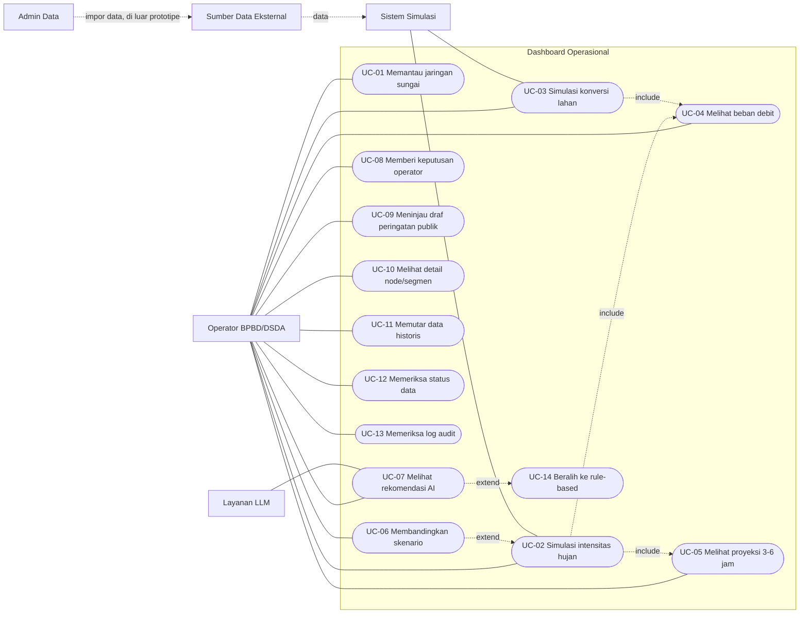

# Use Case — Dashboard Operasional HydroGraph-AI

Lihat juga: `requirements.md`, `user-stories.md`, `traceability.md`.

## 1. Aktor

| Aktor | Tipe | Deskripsi |
|---|---|---|
| Operator BPBD/DSDA | Primer | Petugas yang memantau kondisi sungai, menjalankan simulasi, dan memberi keputusan rekomendasi |
| Admin Data | Primer (di luar prototipe) | Mengelola impor SHP, DEMNAS, dan data TMA. Hanya relevan untuk arsitektur |
| Sistem Simulasi | Sekunder | Menghitung debit, routing graf, proyeksi, dan confidence |
| Layanan LLM | Sekunder | Menghasilkan narasi rekomendasi (Gemini, atau mock pada prototipe) |
| Sumber Data Eksternal | Sekunder | TMA DSDA, BMKG/CHIRPS, GEE. Hanya relevan untuk arsitektur |

## 2. Diagram Use Case

Catatan: Mermaid belum mendukung diagram use case secara native. Diagram di bawah memakai `flowchart` dengan konvensi: aktor berbentuk kotak, use case berbentuk elips `([ ])`.

## 3. Daftar Use Case

| ID | Nama | Aktor utama | Requirement |
|---|---|---|---|
| UC-01 | Memantau jaringan sungai | Operator | FR-01, FR-02, FR-03, FR-06 |
| UC-02 | Simulasi intensitas hujan | Operator | FR-07, FR-11, FR-12 |
| UC-03 | Simulasi konversi lahan | Operator | FR-08, FR-11, FR-12 |
| UC-04 | Melihat beban debit per segmen | Operator | FR-13 |
| UC-05 | Melihat proyeksi volume 3–6 jam | Operator | FR-14, FR-22 |
| UC-06 | Membandingkan skenario | Operator | FR-09, FR-10 |
| UC-07 | Melihat rekomendasi taktis AI | Operator | FR-20, FR-21, FR-22, FR-23, FR-R4, FR-R5 |
| UC-08 | Memberi keputusan operator | Operator | FR-24, FR-25, FR-R1 |
| UC-09 | Meninjau draf peringatan publik | Operator | FR-26 |
| UC-10 | Melihat detail node/segmen | Operator | FR-05 |
| UC-11 | Memutar data historis banjir | Operator | FR-15 |
| UC-12 | Memeriksa status data & layanan | Operator | FR-28, FR-29, FR-30 |
| UC-13 | Memeriksa log audit | Operator | NFR-11 |
| UC-14 | Beralih ke rule-based fallback | Sistem (diperluas dari UC-07) | FR-21, FR-27, FR-R3 |

## 4. Spesifikasi Use Case

### UC-01 — Memantau jaringan sungai

| Field | Isi |
|---|---|
| Aktor | Operator |
| Pra-kondisi | Dashboard dibuka. Data node dan edge tersedia. |
| Pasca-kondisi | Operator melihat kondisi terkini seluruh koridor pada peta. |
| Alur utama | 1. Operator membuka `/ops`. 2. Sistem menampilkan peta dengan node dan edge. 3. Warna dan ukuran node menunjukkan level dan debit. 4. Operator mengganti mode 2D/3D atau menyalakan/mematikan layer. |
| Alur alternatif | A1: Data node tidak tersedia. Sistem menampilkan state error (O-08) dan daftar node dalam bentuk tabel. |
| Pengecualian | E1: Peta gagal dimuat. Sistem menampilkan daftar segmen sebagai pengganti peta. |

### UC-02 — Simulasi intensitas hujan

| Field | Isi |
|---|---|
| Aktor | Operator |
| Pra-kondisi | UC-01 sudah berjalan. |
| Pasca-kondisi | Peta, grafik, dan rekomendasi menampilkan hasil untuk intensitas baru. |
| Alur utama | 1. Operator menggeser slider intensitas hujan. 2. Nilai di layar berubah langsung. 3. Setelah input berhenti 300 ms, sistem meminta hasil simulasi. 4. Peta, grafik, dan panel rekomendasi diperbarui. |
| Alur alternatif | A1: Operator memakai preset skenario cepat (FR-09). |
| Pengecualian | E1: Simulasi gagal. Sistem menampilkan pesan dan mempertahankan hasil sebelumnya dengan label "Belum diperbarui". |

### UC-03 — Simulasi konversi lahan

| Field | Isi |
|---|---|
| Aktor | Operator |
| Pra-kondisi | UC-01 sudah berjalan. |
| Pasca-kondisi | Hasil simulasi mencerminkan perubahan C-value di Depok. |
| Alur utama | 1. Operator memilih tingkat konversi (0, 10, 20, 30%). 2. Sistem menghitung ulang C-value segmen Depok. 3. Peta, grafik, dan rekomendasi diperbarui. |
| Pengecualian | E1: Nilai di luar batas ditolak dan kontrol kembali ke nilai terakhir yang valid. |

### UC-04 — Melihat beban debit per segmen

| Field | Isi |
|---|---|
| Aktor | Operator |
| Pra-kondisi | Hasil simulasi tersedia. |
| Pasca-kondisi | Operator melihat debit per segmen terhadap ambang siaga dan waspada. |
| Alur utama | 1. Operator membuka grafik debit. 2. Sistem menampilkan debit per segmen dengan garis ambang. 3. Operator mengarahkan kursor atau fokus ke titik untuk melihat nilai. |

### UC-05 — Melihat proyeksi volume 3–6 jam

| Field | Isi |
|---|---|
| Aktor | Operator |
| Pra-kondisi | Hasil simulasi tersedia. |
| Pasca-kondisi | Operator melihat akumulasi volume dan pita confidence untuk 3–6 jam. |
| Alur utama | 1. Sistem menampilkan proyeksi per jam. 2. Pita confidence ditampilkan. 3. Jika confidence < 85%, label konfirmasi lapangan tampil. |

### UC-06 — Membandingkan skenario

| Field | Isi |
|---|---|
| Aktor | Operator |
| Pra-kondisi | Skenario baseline tersedia. |
| Pasca-kondisi | Operator melihat selisih baseline dan skenario. |
| Alur utama | 1. Operator mengaktifkan mode perbandingan. 2. Sistem menampilkan baseline dan skenario berdampingan. 3. Sistem menampilkan selisih debit dan volume per segmen. |

### UC-07 — Melihat rekomendasi taktis AI

| Field | Isi |
|---|---|
| Aktor | Operator, Layanan LLM |
| Pra-kondisi | Hasil simulasi tersedia. |
| Pasca-kondisi | Narasi rekomendasi tampil dengan sumber, confidence, dan waktu generasi. |
| Alur utama | 1. Setelah simulasi selesai, sistem meminta narasi ke adapter LLM. 2. Adapter memanggil LLM (mock). 3. Sistem memvalidasi angka dalam narasi (FR-R5). 4. Narasi tampil dengan badge "AI". 5. Jika confidence < 85%, label konfirmasi lapangan tampil. |
| Alur alternatif | A1: LLM timeout atau gagal → UC-14. A2: Validasi angka gagal → UC-14. |

### UC-08 — Memberi keputusan operator

| Field | Isi |
|---|---|
| Aktor | Operator |
| Pra-kondisi | Rekomendasi berstatus Pending tampil. |
| Pasca-kondisi | Status rekomendasi berubah dan keputusan tercatat di log audit (UC-13). |
| Alur utama | 1. Operator membaca narasi. 2. Operator memilih Diterima, Ditolak, atau Perlu Verifikasi. 3. Sistem memperbarui status dan menambah entri log. 4. Sistem menampilkan toast konfirmasi. |
| Catatan | Sistem tidak menjalankan aksi fisik. Keputusan hanya tercatat (FR-R1). |

### UC-09 — Meninjau draf peringatan publik

| Field | Isi |
|---|---|
| Aktor | Operator |
| Pra-kondisi | Level risiko dan rekomendasi tersedia untuk minimal satu kelurahan. |
| Pasca-kondisi | Operator meninjau dan dapat menyalin teks draf. |
| Alur utama | 1. Operator membuka O-06. 2. Sistem menampilkan draf per kelurahan dengan level risiko, sumber, dan waktu. 3. Operator menyalin teks. 4. Sistem tidak mengirim pesan ke warga. |

### UC-10 — Melihat detail node/segmen

| Field | Isi |
|---|---|
| Aktor | Operator |
| Pra-kondisi | Peta tampil. |
| Pasca-kondisi | Panel detail terbuka. |
| Alur utama | 1. Operator mengklik node atau segmen. 2. Panel samping menampilkan debit, TMA, C-value, status, dan sumber. |

### UC-11 — Memutar data historis banjir

| Field | Isi |
|---|---|
| Aktor | Operator |
| Pra-kondisi | Data historis 2020 atau 2021 tersedia. |
| Pasca-kondisi | Peta dan grafik menampilkan kondisi pada waktu yang dipilih. |
| Alur utama | 1. Operator memilih kejadian. 2. Operator menekan play atau menggeser scrub. 3. Peta dan grafik mengikuti waktu. 4. Operator dapat menekan pause. |

### UC-12 — Memeriksa status data & layanan

| Field | Isi |
|---|---|
| Aktor | Operator |
| Pra-kondisi | Dashboard dibuka. |
| Pasca-kondisi | Operator mengetahui kesegaran data dan status layanan. |
| Alur utama | 1. Operator membuka O-07. 2. Sistem menampilkan sumber, waktu pembaruan, label status, dan status layanan. |

### UC-13 — Memeriksa log audit

| Field | Isi |
|---|---|
| Aktor | Operator |
| Pra-kondisi | Ada keputusan atau pemanggilan LLM. |
| Pasca-kondisi | Operator melihat riwayat dan dapat mengekspor. |
| Alur utama | 1. Operator membuka riwayat keputusan. 2. Sistem menampilkan waktu WIB, ID rekomendasi, keputusan, dan sumber narasi. |

### UC-14 — Beralih ke rule-based fallback

| Field | Isi |
|---|---|
| Aktor | Sistem |
| Pemicu | Timeout LLM (5 detik), error, atau validasi angka gagal. |
| Pasca-kondisi | Rekomendasi rule-based tampil dengan badge "Rule-based". |
| Alur utama | 1. Adapter membatalkan permintaan LLM. 2. Adapter membuat narasi dari template aturan. 3. Sistem menandai sumber sebagai rule-based. 4. Sistem menampilkan teks singkat "Narasi AI tidak tersedia, menggunakan aturan standar". |
