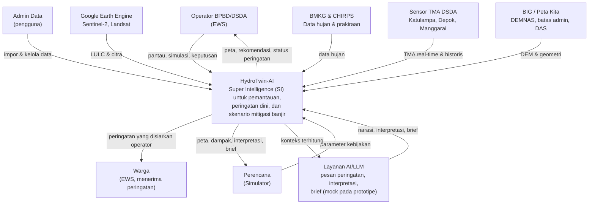

# C4 Level 1 — System Context

Menunjukkan HydroTwin-AI sebagai satu kotak dengan pengguna dan sistem eksternal di sekitarnya. Sistem memiliki dua use case utama: **Early Warning System (EWS)** dan **Simulator**.

## Batas Sistem

| Di dalam | Di luar |
|---|---|
| Dashboard operator EWS | Pemodelan hidrologi lanjutan (kalibrasi, Manning penuh) |
| Halaman warga dan feed peringatan yang disiarkan operator | Pengiriman SMS/WhatsApp/push notification dan integrasi broadcast BPBD |
| Simulator parameter + interpretasi + Executive Brief | Autentikasi, RBAC, dan manajemen sesi produksi |
| Layanan simulasi dan graf | Kontrol pintu air dan pompa fisik |
| Adapter LLM, validator, dan fallback | Provider AI produksi dengan API key di server |
| Log audit keputusan dan siklus peringatan | Peta zonasi desa, GPS, dan offline penuh (lihat `plan/web-publik.md`) |

## Catatan

- Sistem tidak memberikan kendali fisik ke sistem lain. Panah dari sistem ke infrastruktur sengaja tidak ada (FR-R1).
- Warga tidak pernah menerima hasil simulasi langsung. Hanya peringatan berstatus `disiarkan` yang mengalir ke halaman warga (FR-34, FR-R10).
- AI tidak menentukan level risiko; level berasal dari hasil pemodelan (FR-R8).
