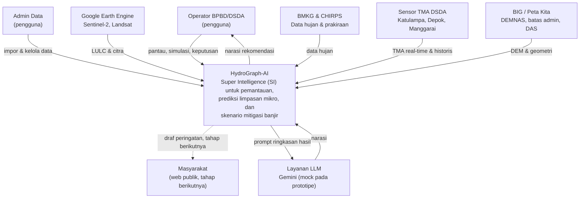

# C4 Level 1 — System Context

Menunjukkan HydroGraph-AI sebagai satu kotak dengan pengguna dan sistem eksternal di sekitarnya.

## Batas Sistem

| Di dalam | Di luar |
|---|---|
| Dashboard operasional | Pemodelan hidrologi lanjutan (kalibrasi, Manning penuh) |
| Layanan simulasi dan graf | Pengiriman peringatan ke warga |
| Adapter LLM dan fallback | Kontrol pintu air dan pompa fisik |
| Log audit keputusan | Sistem SMS/broadcast BPBD |

## Catatan

- Sistem tidak memberikan kendali fisik ke sistem lain. Panah dari sistem ke infrastruktur sengaja tidak ada (FR-R1).
- Web publik ditampilkan dengan garis putus-putus karena di luar lingkup tahap ini.
