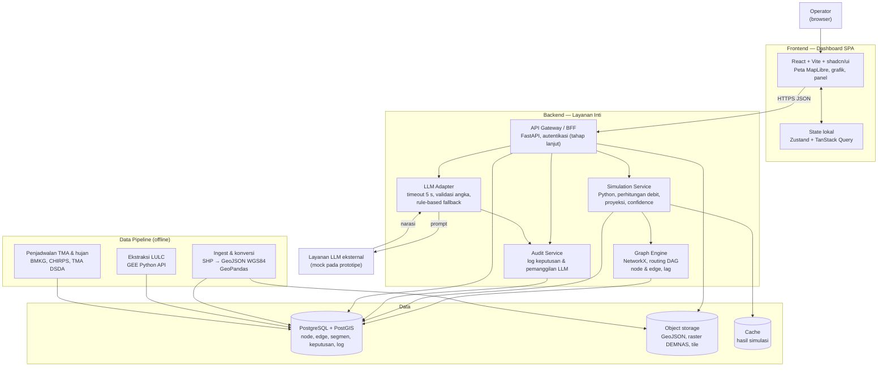

# C4 Level 2 — Container Diagram

Menunjukkan komponen deployable utama dan bagaimana mereka berkomunikasi.

## Daftar Kontainer

| Kontainer | Teknologi | Tanggung jawab | Tahap |
|---|---|---|---|
| Dashboard SPA | React 19, Vite, TypeScript, Tailwind, shadcn/ui, MapLibre | Semua UI operator, state UI | Prototipe sekarang |
| API Gateway / BFF | FastAPI (Python) | Kontrak API ke frontend, validasi input, orkestrasi | Produksi |
| Simulation Service | Python, NumPy, Pandas | Rational Method, routing, proyeksi, confidence | Produksi (mock pada prototipe) |
| Graph Engine | NetworkX | Representasi DAG node dan edge | Produksi |
| LLM Adapter | Python, httpx | Panggilan LLM, timeout, validasi, fallback | Produksi (mock pada prototipe) |
| Audit Service | Python, PostgreSQL | Log keputusan dan pemanggilan LLM | Produksi |
| PostgreSQL + PostGIS | PostgreSQL 16, PostGIS | Data relasional dan spasial | Produksi |
| Object storage | S3-compatible | GeoJSON, raster DEMNAS, tile | Produksi |
| Data pipeline | GeoPandas, GEE Python API, penjadwal | Ingest dan pembaruan data | Di luar tahap ini |

## Protokol

| Dari | Ke | Protokol | Catatan |
|---|---|---|---|
| Browser | API Gateway | HTTPS, JSON | Kontrak di `docs/architecture/api-contract.md` (tahap berikutnya) |
| LLM Adapter | LLM eksternal | HTTPS | API key hanya di server (FR-R7) |
| Pipeline | PostgreSQL | SQL | Upsert idempoten |

## Keputusan Terkait

- ADR-004 (LLM adapter dan fallback)
- ADR-006 (stack backend)
- Detail komponen frontend: `03-component-frontend.md`
