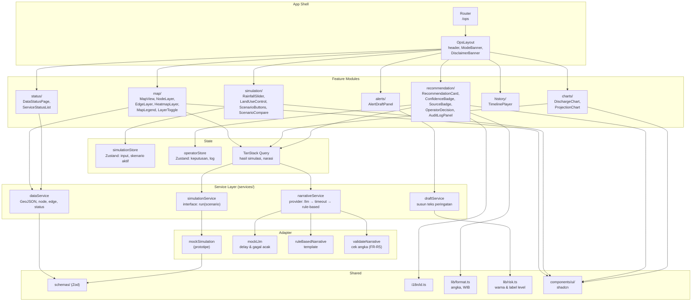

# C4 Level 3 — Component Diagram (Frontend Dashboard)

Komponen di dalam Dashboard SPA. Prototipe mengimplementasikan layanan dengan mock, tetapi kontraknya sama dengan layanan produksi.

## Aturan Dependensi

- Feature tidak boleh mengimpor feature lain. Berbagi lewat store atau `shared/`.
- Komponen tidak memanggil adapter langsung. Selalu lewat service.
- `services/` tidak mengimpor React.
- Adapter mock dan adapter produksi memiliki interface yang sama. Berganti implementasi cukup mengubah binding di satu tempat.
- Tidak ada `fetch` di komponen (sesuai `01-rules.md`).

## Kontrak Layanan (ringkas)

| Layanan | Input | Output |
|---|---|---|
| `simulationService.run` | `{ intensitasMmJam, konversiLahanPersen, scenarioId? }` | `{ hasilId, debitPerNode, debitPerSegmen, proyeksi[], confidence, dihitungPada }` |
| `narrativeService.generate` | `hasil` | `{ teks, sumber: 'llm' \| 'rule_based', confidence, modelLabel, dibuatPada }` |
| `dataService.getNodes` | — | `Node[]` + `status` |
| `draftService.build` | `rekomendasi, segmen` | `{ level, teksPublik, estimasiTibaMenit }` |

Detail lengkap ada di Zod schema (`schemas/`).
