# C4 Level 3 — Component Diagram (Frontend)

Komponen di dalam SPA HydroTwin-AI. Prototipe mengimplementasikan layanan dengan mock, tetapi kontraknya sama dengan layanan produksi. Ada tiga surface: `/ops` dan `/warga` untuk EWS, `/rencana` untuk Simulator.

```mermaid
flowchart TB
    subgraph APP["App Shell"]
        ROUTER["Router<br/>/ops · /warga · /rencana"]
        LAYOUT["OpsLayout<br/>header, ModeBanner,<br/>DisclaimerBanner"]
    end

    subgraph EWSF["EWS Features"]
        MAPF["map/<br/>MapView, NodeLayer,<br/>EdgeLayer, KelurahanLayer"]
        SIMF["simulation/<br/>RainfallSlider,<br/>LandUseControl,<br/>ScenarioButtons"]
        CHARTF["charts/<br/>DischargeChart,<br/>ProjectionChart"]
        RECF["recommendation/<br/>RecommendationCard,<br/>OperatorDecision, AuditLogPanel"]
        ALERTF["alerts/<br/>AlertReviewSheet"]
        WARGA["public/<br/>PublicAlertCard,<br/>WilayahPicker"]
        STATUSF["status/<br/>StatusSheet"]
    end

    subgraph SIMFEAT["Simulator Features"]
        PARAM["planner/<br/>ScenarioPanel,<br/>PlannerParameter"]
        IMPACT["planner/<br/>ImpactPanel,<br/>KelurahanDetail"]
        INTERP["planner/<br/>InterpretationPanel"]
        BRIEF["planner/<br/>ExecutiveBrief"]
    end

    subgraph STATE["State"]
        SIMSTORE["simulationStore<br/>input operator"]
        OPSTORE["operatorStore<br/>keputusan, peringatan, log"]
        PLANSTORE["plannerStore<br/>parameter simulator"]
        PUBSTORE["publicationService<br/>localStorage + BroadcastChannel"]
        QUERY["TanStack Query<br/>simulasi, narasi"]
    end

    subgraph SVC["Service Layer"]
        SIMSVC["simulationService<br/>run(scenario)"]
        ALERTSVC["alertService<br/>kandidat peringatan per wilayah"]
        PUBSVC["publicationService<br/>siarkan / tarik / kedaluwarsa"]
        PLANNERSVC["planner engine<br/>runPlanner, registry parameter"]
        NARR["llm pipeline<br/>timeout → validasi → fallback"]
        TASKS["llm/tasks<br/>rekomendasi, peringatan,<br/>interpretasi, brief"]
    end

    subgraph ADAPT["Adapter"]
        MOCKSIM["mockSimulation"]
        MOCKLLM["mockLlm<br/>delay & gagal terkontrol"]
        TEMPLATE["template fallback"]
        VALID["validator angka + tone"]
    end

    subgraph SHARED["Shared"]
        SCHEMA["schemas/ (Zod)"]
        I18N["i18n/ (id, en, teks)<br/>default EN, toggle ID/EN"]
        FMT["lib/format.ts<br/>locale-aware numbers"]
        UI["components/ui/"]
    end

    ROUTER --> LAYOUT
    LAYOUT --> EWSF
    LAYOUT --> SIMFEAT

    SIMF --> SIMSTORE
    RECF --> OPSTORE
    ALERTF --> OPSTORE
    WARGA --> PUBSTORE
    PARAM --> PLANSTORE
    MAPF --> QUERY
    CHARTF --> QUERY
    IMPACT --> PLANNERSVC

    QUERY --> SIMSVC
    QUERY --> NARR
    ALERTF --> ALERTSVC
    ALERTF --> PUBSVC
    WARGA --> PUBSVC
    INTERP --> TASKS
    BRIEF --> TASKS
    TASKS --> NARR

    SIMSVC --> MOCKSIM
    NARR --> MOCKLLM
    NARR --> TEMPLATE
    NARR --> VALID
    ALERTSVC --> MOCKSIM

    EWSF --> UI
    SIMFEAT --> UI
    EWSF --> I18N
    SIMFEAT --> I18N
    RECF --> FMT
    EWSF --> SCHEMA
    SIMFEAT --> SCHEMA
```

## Aturan Dependensi

- Feature tidak boleh mengimpor feature lain. Berbagi lewat store atau `shared/`.
- Komponen tidak memanggil adapter langsung. Selalu lewat service.
- `services/` tidak mengimpor React.
- Adapter mock dan adapter produksi memiliki interface yang sama. Berganti implementasi cukup mengubah binding di satu tempat.
- Halaman warga hanya boleh mengimpor `publicationService`, bukan `simulationService` atau `planner` engine.
- Tidak ada `fetch` di komponen (sesuai `01-rules.md`).

## Kontrak Layanan (ringkas)

| Layanan | Input | Output |
|---|---|---|
| `simulationService.run` | `{ intensitasMmJam, konversiLahanPersen, scenarioId? }` | `{ hasilId, debitPerNode, debitPerSegmen, proyeksi[], confidence, dihitungPada }` |
| `alertService.buildKandidatPeringatan` | `hasil simulasi, network, catchments` | `Peringatan[]` kandidat per wilayah |
| `publicationService.siarkan` | `Peringatan` | `Peringatan` berstatus `disiarkan` + event channel |
| `publicationService.tarik` | `peringatanId` | `Peringatan` berstatus `ditarik` + event channel |
| `publicationService.daftarAktif` | `indeks?` | `Peringatan[]` berstatus disiarkan dan belum kedaluwarsa |
| `llm.generate` | `task, konteks terhitung` | `{ teks, sumber: 'llm' \| 'template', modelLabel, dibuatPada }` |
| `llm.generatePeringatanPublik` | `PeringatanContext` | `{ teks, sumber, modelLabel, dibuatPada, alasanFallback? }` |
| `llm.generatePlannerNarrative` | `PlannerNarrativeContext, jenis` | `{ teks, sumber, modelLabel, dibuatPada, versi, alasanFallback? }` |
| `plannerRegistry` | — | `PlannerParameter[]` (id, kind, label, satuan, batas, default, sumber) |
| `planner.run` | `parameter` | `{ perKelurahan, ringkasan }` |

Detail lengkap ada di Zod schema (`schemas/`).
