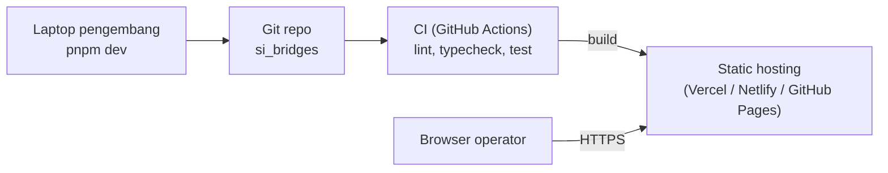
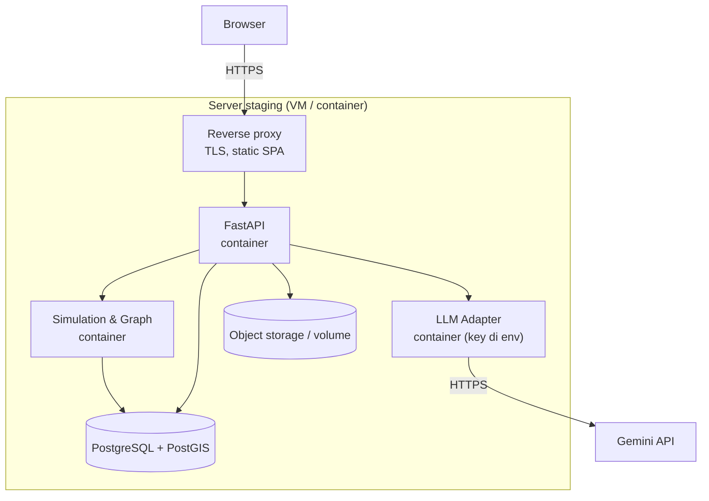

# Deployment Diagram

Tiga lingkungan: prototipe (sekarang), staging (untuk demo Gate), dan produksi (target setelah pilot).

## 1. Prototipe (Tahap Sekarang)



Catatan: semua data dan layanan (simulasi, LLM) berjalan di browser dengan mock. Tidak ada backend.

## 2. Staging (Demo Gate)



## 3. Produksi (Target)

```mermaid
flowchart TB
    subgraph NET_DMZ["Zona publik"]
        WAF["WAF & TLS"]
        PUBFE["Web publik<br/>(tahap berikutnya)"]
    end
    subgraph NET_INT["Zona internal BPBD/DSDA"]
        OPFE["Dashboard operator"]
        GW["API Gateway"]
        subgraph K8S["Container platform"]
            SIM["Simulation service"]
            GRAPH["Graph engine"]
            LLMA["LLM adapter"]
            AUD["Audit service"]
        end
        PG[("PostgreSQL + PostGIS<br/>replica")]
        OBJ[("Object storage")]
        VAULT["Secret store<br/>API key LLM"]
        LOG["Log & monitoring"]
    end
    LLMEXT["Gemini API"]

    OPFE -->|HTTPS, SSO (tahap lanjut)| WAF
    WAF --> GW
    PUBFE --> WAF
    GW --> SIM
    GW --> AUD
    GW --> LLMA
    SIM --> GRAPH
    SIM --> PG
    AUD --> PG
    LLMA --> VAULT
    LLMA -->|HTTPS| LLMEXT
    GW --> OBJ
    SIM --> LOG
    LLMA --> LOG
```

## 4. Catatan Keamanan

- API key LLM hanya ada di secret store atau environment server (FR-R7, NFR-05).
- Dashboard operator berada di zona internal. Akses publik hanya ke web publik (tahap berikutnya).
- Log tidak memuat isi prompt yang berisi data sensitif. Hanya ID dan metadata.
- Lokasi pengguna tidak disimpan (NFR-06).

## 5. Ketersediaan

| Komponen | Target | Catatan |
|---|---|---|
| Dashboard | 99% selama jam operasional | Static hosting cukup untuk prototipe |
| Simulation | 99% | Cache hasil terakhir saat gangguan |
| LLM Adapter | Fallback ≤ 5 detik | Rule-based selalu tersedia (NFR-07) |
| Audit | Tidak boleh kehilangan entri | Tulis sinkron ke PostgreSQL |
