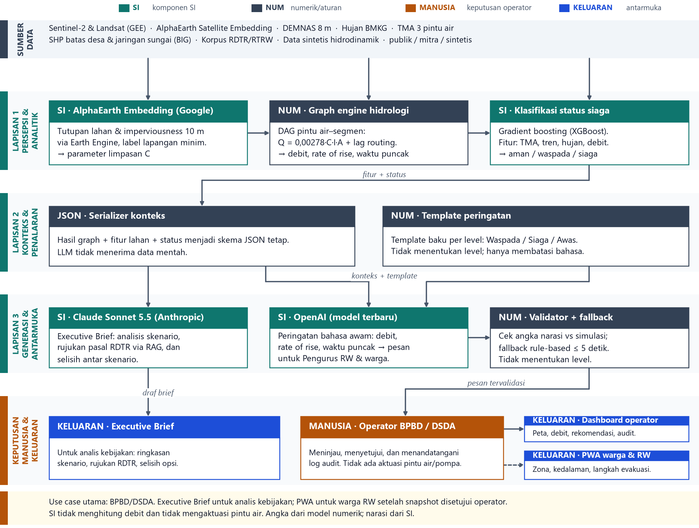
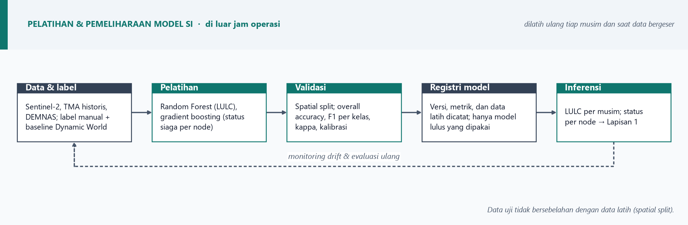

# Arsitektur SI — Tiga Lapisan

Dokumen ini menjelaskan lapisan SI pada **HydroTwin-AI** (view subsistem). Arsitektur SPBE enam domain ada di `06-arsitektur-spbe.md`.



*Gambar 1. Lapisan persepsi & analitik, konteks & penalaran, serta generasi & antarmuka. Dua use case: Early Warning System (operator + warga) dan Simulator (perencana). Hijau = komponen SI, abu-abu = numerik/aturan, oranye = keputusan manusia, biru = keluaran.*

## Prinsip

1. **SI tidak menghitung debit.** Debit, rate of rise, dan waktu puncak berasal dari graph engine deterministik (Rational Method + lag routing pada prototipe; kalibrasi hidrologi pada tahap pendampingan).
2. **LLM tidak menerima data mentah.** Hanya JSON konteks yang sudah dihitung, ditambah template peringatan atau potongan RDTR via RAG.
3. **Dua jalur model.** Claude menyusun interpretasi skenario dan Executive Brief untuk perencana; OpenAI menulis pesan peringatan bahasa awam untuk warga.
4. **Tidak ada aktuasi otomatis.** Pintu air, pompa, dan rute evakuasi tetap kewenangan operator.
5. **Publikasi setelah persetujuan.** Warga hanya melihat peringatan per wilayah yang disiarkan operator. Suntingan operator dan teks AI asli tercatat.
6. **Dua use case, satu inti.** EWS dan Simulator memakai engine, adapter LLM, dan audit yang sama; perbedaannya ada pada alur keputusan dan keluaran.

## Komponen dan status

| Komponen | Lapisan | Peran | Status prototipe |
|---|---|---|---|
| AlphaEarth Satellite Embedding (Google, Earth Engine) | 1 · Persepsi | Tutupan lahan dan imperviousness 10 m → parameter limpasan C, dengan sedikit label lapangan | Rencana; C masih tabel tetap |
| XGBoost (status siaga) | 1 · Persepsi | Klasifikasi status siaga dari TMA, tren, hujan, debit | Rencana; level masih ambang TMA |
| Graph engine | 1 · Analitik | Debit, rate of rise, dan waktu puncak pada DAG | Ada (mock, belum dikalibrasi) |
| Serializer JSON | 2 · Konteks | Mengubah hasil graph + fitur lahan + status menjadi skema tetap | Sebagian (ringkasan input, belum skema formal) |
| Korpus RDTR/RTRW (RAG) | 2 · Konteks | Rujukan pasal untuk Executive Brief | Sebagian (korpus manual) |
| Template peringatan | 2 · Konteks | Batas bahasa per level Waspada/Siaga/Awas | Ada; dipakai sebagai fallback F2 |
| Claude Sonnet 5.5 (Anthropic; API atau Amazon Bedrock) | 3 · Generasi | Interpretasi skenario dan Executive Brief: analisis kebijakan, rujukan RDTR via RAG, selisih antar skenario | Ada (F4, mock) dengan fallback template; RAG belum |
| OpenAI generasi terbaru (OpenAI API atau Azure OpenAI) | 3 · Generasi | Menerjemahkan debit, rate of rise, dan waktu puncak menjadi pesan peringatan bahasa awam untuk RW dan warga | Ada (F2, mock) dengan fallback template |
| Validator + fallback | 3 · Penjaga | Mencocokkan angka narasi dengan simulasi, memeriksa klaim/tone; fallback aturan ≤ 5 detik | Ada untuk rekomendasi, peringatan, interpretasi, dan brief |
| Operator + publikasi peringatan | Manusia | Meninjau, menyunting, menyiarkan, menarik; menandatangani log audit | Ada (F1): publikasi per wilayah, sunting, siarkan/tarik, kedaluwarsa, audit |
| Dashboard, PWA, Executive Brief | Keluaran | Konsol operator, peringatan warga per wilayah, ringkasan untuk perencana | Dashboard dan PWA ada (F1–F2); interpretasi dan brief AI mock ada (F4) |

Catatan model: dua LLM dari perusahaan AS dipisah per beban kerja — Claude untuk penalaran kebijakan, OpenAI untuk bahasa awam. Keduanya diakses lewat adapter agar vendor bisa diganti. AlphaEarth adalah model fondasi geospasial, bukan LLM. Google Earth Engine adalah platform komputasi, bukan model.

## Pipeline pemodelan



*Gambar 2. Data dan label → pelatihan → validasi spasial → registri model → inferensi ke Lapisan 1.*

Aturan validasi:

- **Spatial split**, bukan split acak: data uji tidak bersebelahan dengan data latih.
- Metrik dilaporkan per kelas: overall accuracy, F1, kappa.
- Probabilitas status siaga dikalibrasi (Brier score).
- Baseline pembanding: Dynamic World (10 m, 9 kelas) dan ESA WorldCover 2021 (10 m, 11 kelas, CC-BY-4.0).

## Berkas

| Berkas | Fungsi |
|---|---|
| `figures/arsitektur-sistem.png` | Gambar 300 dpi untuk proposal |
| `figures/pipeline-model-si.png` | Pipeline pemodelan untuk Gambar 2 |
| `scripts/render-architecture-figure.py` | Generator PNG (matplotlib); sumber utama gambar saat ini |
| `figures/arsitektur-sistem.drawio` | Versi editable sebelumnya (belum memuat pemisahan Claude/OpenAI) |

Untuk mengubah gambar saat ini, edit `scripts/render-architecture-figure.py` lalu jalankan:

```bash
python scripts/render-architecture-figure.py
```

`.drawio` lama masih bisa dipakai sebagai acuan tata letak, tetapi teks dan pembagian modelnya belum diperbarui.
