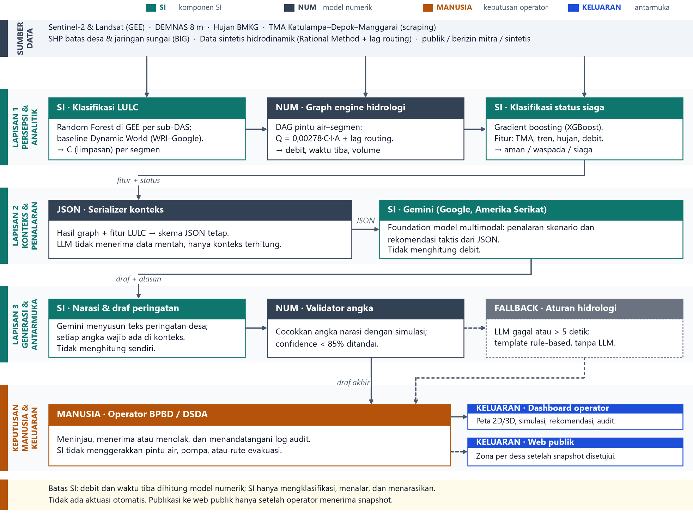
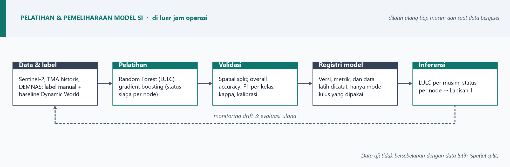

# Arsitektur SI — Tiga Lapisan

Dokumen ini menjelaskan pembagian peran SI pada HydroGraph-AI dan menjadi rujukan Gambar 1–2 di proposal.

*Gambar 1. Lapisan persepsi & analitik, konteks & penalaran, serta generasi & antarmuka. Hijau = komponen SI, abu-abu = model numerik, oranye = keputusan manusia.*

## Prinsip

1. **SI tidak menghitung debit.** Debit, waktu tiba, dan volume berasal dari graph engine deterministik (Rational Method + lag routing pada prototipe; kalibrasi hidrologi pada tahap pendampingan).
2. **LLM tidak menerima data mentah.** Hanya JSON konteks yang sudah dihitung.
3. **Tidak ada aktuasi otomatis.** Pintu air, pompa, dan rute evakuasi tetap kewenangan operator.
4. **Publikasi setelah persetujuan.** Web publik hanya menampilkan snapshot yang diterima operator.

## Komponen dan status

| Komponen | Lapisan | Peran | Status prototipe |
|---|---|---|---|
| Random Forest (GEE) + Dynamic World | 1 · Persepsi | Klasifikasi tutupan lahan Sentinel-2 → C per sub-DAS | Rencana; C masih tabel tetap |
| XGBoost (status siaga) | 1 · Persepsi | Klasifikasi status siaga dari TMA, tren, hujan, debit | Rencana; level masih ambang TMA |
| Graph engine | 1 · Analitik | Propagasi debit dan waktu tiba pada DAG | Ada (mock, belum dikalibrasi) |
| Serializer JSON | 2 · Konteks | Mengubah hasil graph menjadi skema tetap | Sebagian (ringkasan input, belum skema formal) |
| Gemini (Google) | 2 · Penalaran | Penalaran skenario dan rekomendasi taktis; versi generik, dikunci saat implementasi | Mock; adapter dan fallback ada |
| Narasi & draf peringatan | 3 · Generasi | Teks rekomendasi dan peringatan per desa | Mock |
| Validator angka | 3 · Penjaga | Mencocokkan angka narasi dengan simulasi | Ada |
| Fallback aturan | 3 · Penjaga | Layanan tetap jalan ≤ 5 detik tanpa LLM | Ada |
| Operator + snapshot | Manusia | Terima/tolak, tanda tangan log audit | Ada (localStorage + BroadcastChannel) |
| Web publik | Keluaran | Zona hijau/kuning/merah per desa | Rencana (`docs/plan/web-publik.md`) |

Catatan model: Gemini ditulis generik. Versi dan jalur aksesnya dikunci saat implementasi, tanpa mengikat proposal ke satu platform enterprise. Random Forest dan XGBoost dilatih tim sendiri; Google Earth Engine adalah platform komputasi, bukan model SI.

## Pipeline pemodelan

*Gambar 2. Data dan label → pelatihan → validasi spasial → registri model → inferensi ke Lapisan 1.*

Aturan validasi:

- **Spatial split**, bukan split acak: data uji tidak bersebelahan dengan data latih.
- Metrik dilaporkan per kelas: overall accuracy, F1, kappa. Akurasi agregat saja tidak cukup.
- Probabilitas status siaga dikalibrasi (Brier score), karena ambang keputusan lebih penting daripada akurasi mentah.
- Baseline pembanding: Dynamic World (10 m, 9 kelas) dan ESA WorldCover 2021 (10 m, 11 kelas, CC-BY-4.0).

## Berkas dan cara mengubah

| Berkas | Fungsi |
|---|---|
| `figures/arsitektur-sistem.drawio` | Versi editable. Buka di https://app.diagrams.net (File > Open from > Device) atau lewat ekstensi Draw.io Integration di VS Code. |
| `figures/arsitektur-sistem.png` | Gambar 300 dpi yang dipakai proposal. |
| `figures/pipeline-model-si.png` | Pipeline pemodelan untuk Gambar 2. |
| `scripts/render-drawio-architecture.py` | Generator `.drawio`. |
| `scripts/render-architecture-figure.py` | Generator PNG (matplotlib). |

Setiap komponen pada `.drawio` adalah **grup** berisi bilah judul dan badan teks, jadi bisa digeser, diubah, atau digandakan tanpa merusak yang lain. Warna yang dipakai: `#0F766E` (SI), `#334155` (numerik), `#B45309` (manusia), `#1D4ED8` (keluaran), `#6B7280` (fallback).

Jika mengubah `.drawio`:

1. Ekspor PNG 300 dpi tanpa background (`File > Export as > PNG`, zoom/DPI 300).
2. Timpa `figures/arsitektur-sistem.png`.
3. Jalankan `python scripts/fill-proposal.py` lalu ekspor ulang PDF.

Jangan menjalankan `render-architecture-figure.py` setelah menimpa PNG, karena skrip itu akan menulis ulang gambar dari layout matplotlib.

