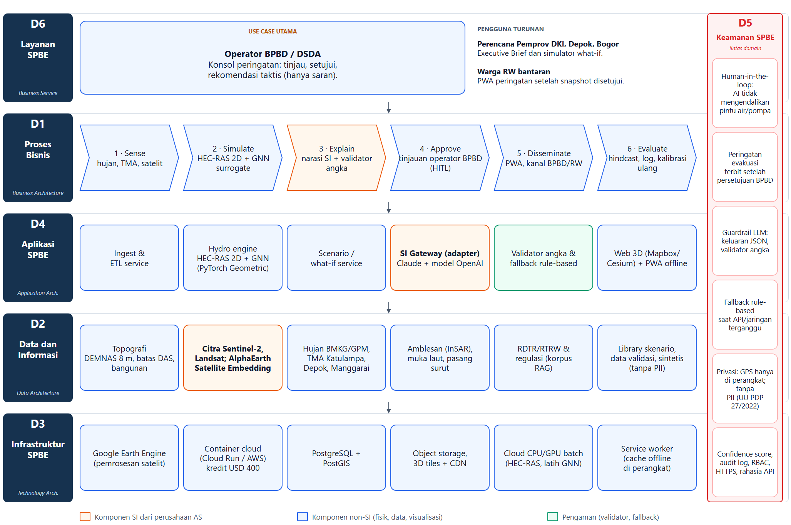

# Arsitektur SPBE — HydroTwin-AI

Diagram arsitektur helicopter view untuk HydroTwin-AI, mengikuti enam domain Arsitektur SPBE. Menggantikan diagram tiga lapisan pada `05-arsitektur-si.md` yang dibuat untuk konsep HydroGraph-AI.



*Gambar. Arsitektur SPBE untuk use case utama BPBD/DSDA. Data mengalir dari bawah (D3) ke atas (D6); D5 berlaku untuk semua domain. Perencana (Executive Brief dan simulator what-if) serta warga RW (PWA) adalah pengguna turunan yang disebut secara tekstual, bukan kotak layanan terpisah.*

## Isi per domain

| Domain | Isi |
|---|---|
| **D6 Layanan** | Use case utama: konsol operator BPBD/DSDA. Pengguna turunan: perencana (Executive Brief + simulator what-if) dan warga RW (PWA). |
| **D1 Proses bisnis** | Sense → Simulate → Explain → Approve (HITL) → Disseminate → Evaluate |
| **D4 Aplikasi** | Ingest/ETL, hydro engine (HEC-RAS 2D + GNN), scenario service, SI gateway, validator + fallback, web 3D/PWA |
| **D2 Data** | DEMNAS, Sentinel-2/Landsat/AlphaEarth, hujan BMKG/GPM, TMA, amblesan/pasang, RDTR (RAG), library skenario |
| **D3 Infrastruktur** | Earth Engine, container cloud, PostgreSQL/PostGIS, object storage/CDN, GPU batch, service worker |
| **D5 Keamanan** | HITL, persetujuan BPBD, guardrail LLM, fallback, privasi GPS, audit/RBAC/HTTPS |

## Batas SI

- **SI perusahaan AS:** Claude (Executive Brief), model OpenAI (kartu peringatan), AlphaEarth Satellite Embedding (fitur tutupan lahan). Akses lewat adapter agar vendor bisa diganti.
- **Non-SI:** HEC-RAS 2D, GNN surrogate, PostgreSQL/PostGIS, Mapbox/Cesium, PWA.
- **Pengaman:** validator angka, fallback rule-based, persetujuan operator. SI tidak menentukan level siaga dan tidak mengaktuasi pintu air/pompa.

## Berkas

| Berkas | Fungsi |
|---|---|
| `figures/arsitektur-spbe-hydrotwin.drawio` | Sumber editable (draw.io / VS Code Draw.io Integration) |
| `figures/arsitektur-spbe-hydrotwin.png` | Ekspor 2055 × 1365 px untuk proposal |
| `scripts/render-drawio-spbe.py` | Generator `.drawio` |

Setelah mengubah `.drawio`, ekspor ulang PNG lewat draw.io, atau render dari viewer:

```bash
# dari root repo; butuh Edge/Chrome dan server statis untuk file preview
python scripts/render-drawio-spbe.py
```

Kanvas 2055 px lebar; saat ditempel selebar 17,8 cm di A4, teks sekitar 6 pt dan masih terbaca.
