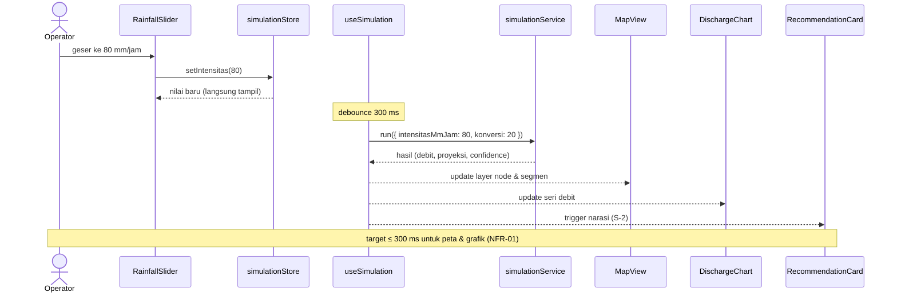
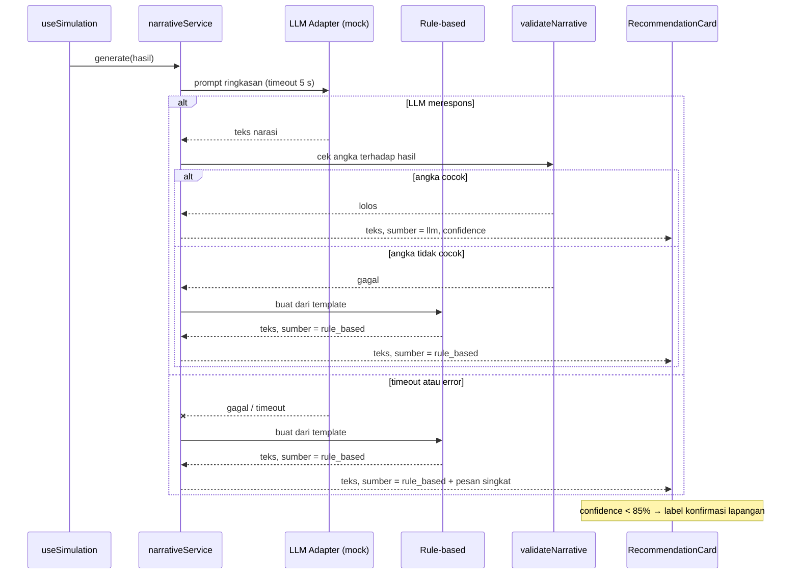
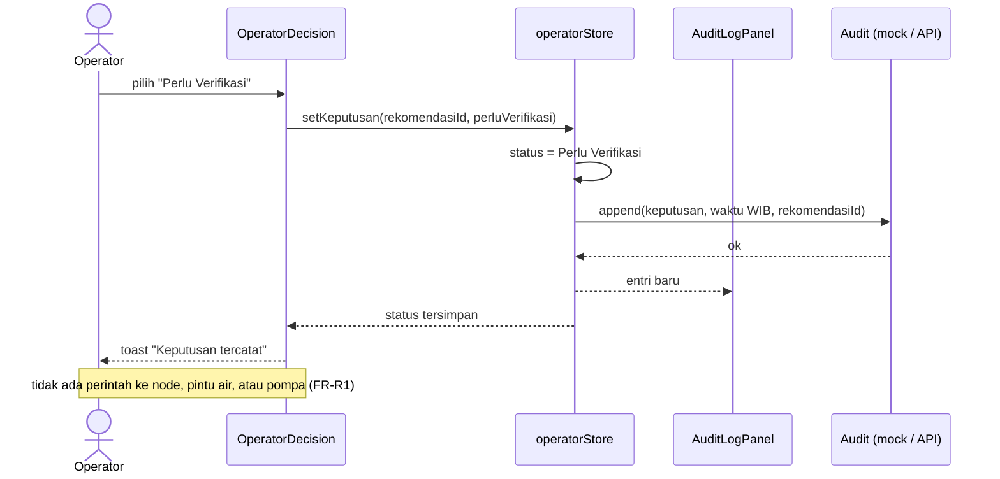
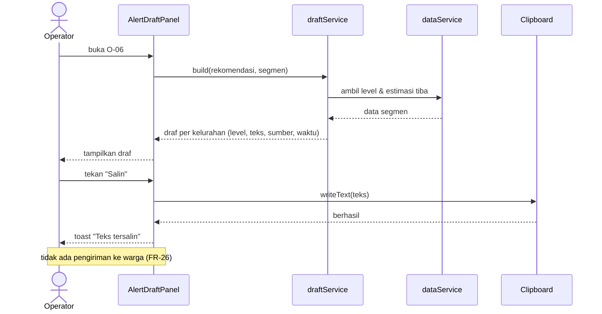

# Sequence Diagram

Empat alur utama dashboard. Setiap diagram merujuk ke use case di `docs/analysis/use-cases.md`.

## S-1 — Geser Slider Hujan (UC-02)

## S-2 — Narasi AI dengan Fallback (UC-07, UC-14)

## S-3 — Keputusan Operator (UC-08)

## S-4 — Meninjau Draf Peringatan Publik (UC-09)

