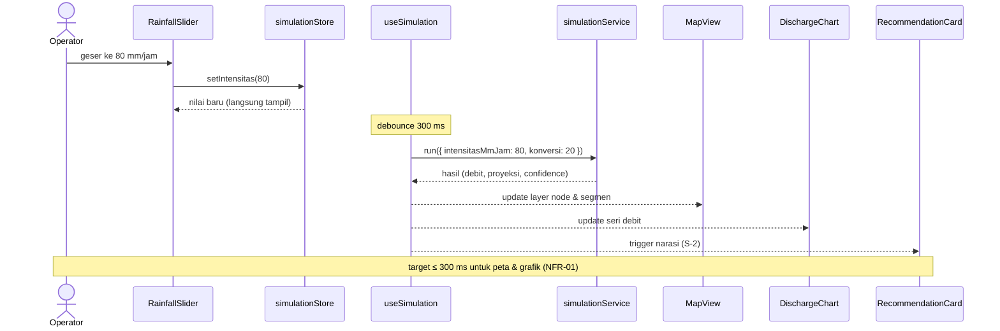
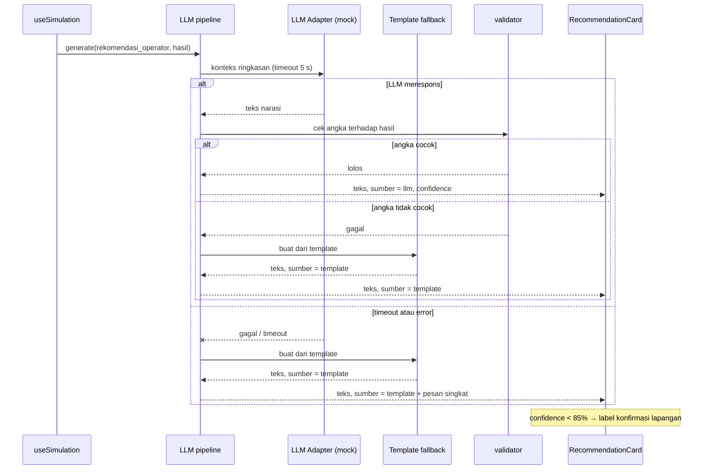
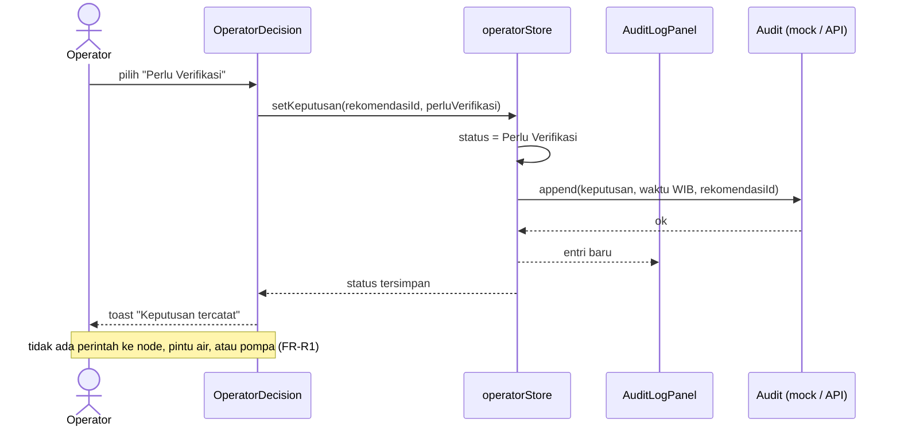
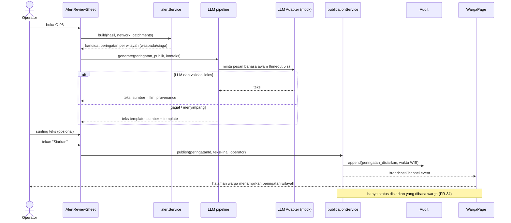
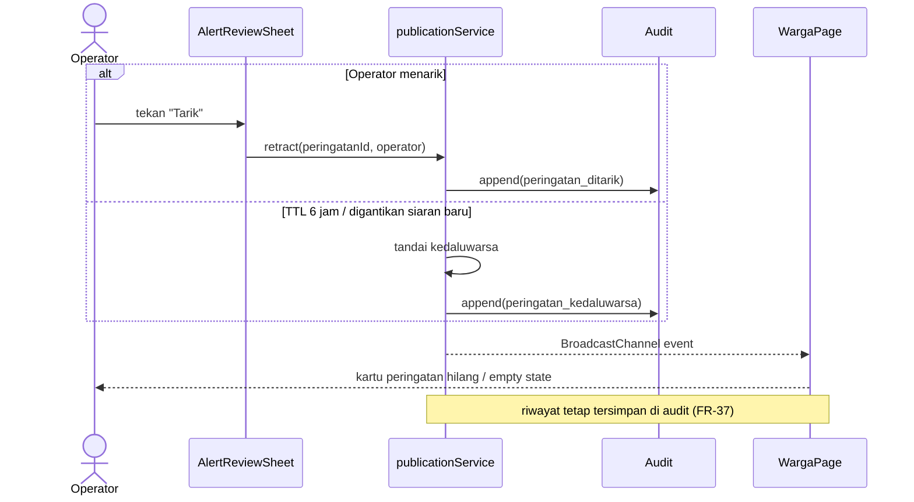
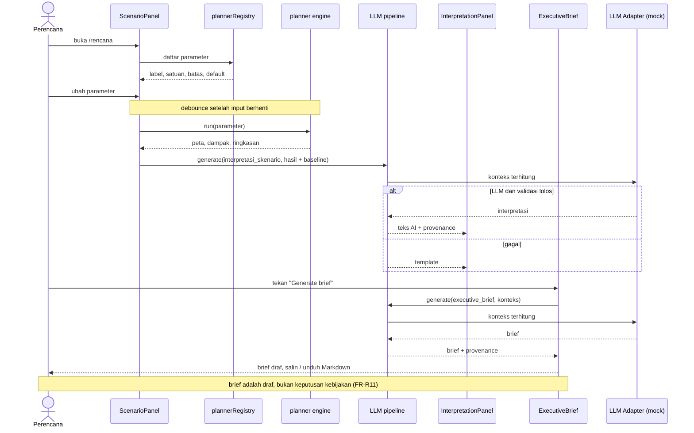

# Sequence Diagram

Alur utama EWS dan Simulator. Setiap diagram merujuk ke use case di `docs/analysis/use-cases.md`.

## S-1 — Geser Slider Hujan (UC-02)

## S-2 — Narasi AI dengan Fallback (UC-07, UC-14)

## S-3 — Keputusan Operator (UC-08)

## S-4 — Menyusun, Menyunting, dan Menyiarkan Peringatan (UC-09)

## S-5 — Menarik atau Kedaluwarsa Peringatan (UC-16)

## S-6 — Simulator: Parameter, Interpretasi, Brief (UC-20–UC-23)

