# UI Prototipe — HydroTwin-AI

Dokumen ini mendeskripsikan prototipe frontend HydroTwin-AI. Kode ada di `apps/dashboard/`.

| Item | Isi |
|---|---|
| Use case | **Early Warning System** (`/ops` operator + `/warga`) dan **Simulator** (`/rencana` perencana) |
| Tim | Tim SWE: Yovi Maulana Nugraha (UI/UX & mockup), Argo Nurcahyo (arsitektur & review) |
| Fidelity | Mockup visual lengkap, prototipe React interaktif |
| Stack | React 19, Vite, TypeScript, Tailwind CSS v4, shadcn/ui, MapLibre GL JS, Recharts |
| Data | Mock dari SHP dan DEMNAS; 237 poligon kelurahan dari BPS 2020 |
| Bahasa | English (default) dan Bahasa Indonesia; pilihan ID/EN di header dan halaman warga |

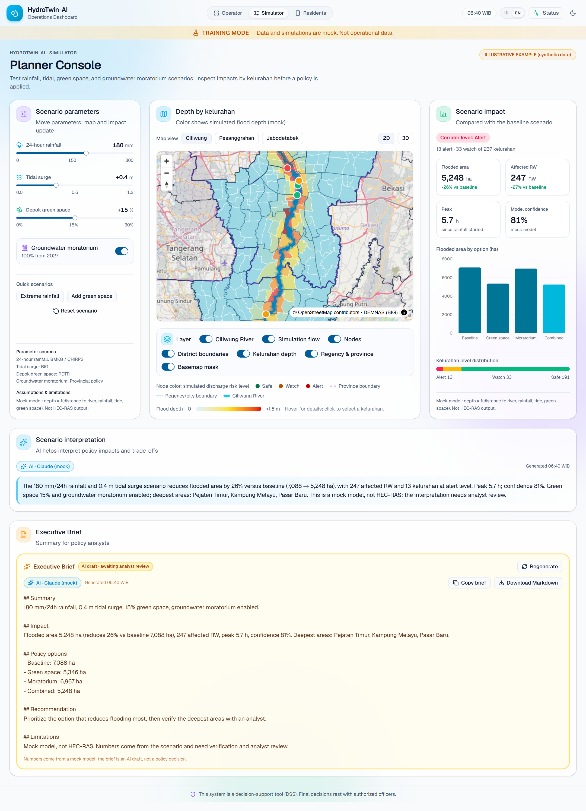

*Tampilan utama: Konsol Perencana — parameter skenario, heatmap kedalaman per kelurahan, dampak skenario, dan Executive Brief.*

## 1. Site Map

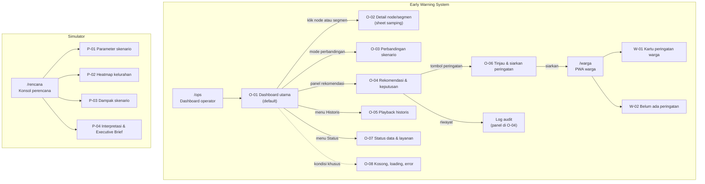

Navigasi utama berada di header dengan dua kelompok: **Peringatan Dini** (Operator + Warga) dan **Simulator** (Perencana). O-02 dan O-03 terbuka sebagai panel di atas O-01.

## 2. Struktur Layar

```
┌───────────────────────────────────────────────────────────────────────────┐
│ Header: logo · MODE LATIHAN · status layanan · waktu WIB · tema · menu   │
├──────────────┬──────────────────────────────────────┬─────────────────────┤
│ Panel kontrol│ PETA (2D/3D, node, edge, heatmap)    │ Panel rekomendasi   │
│ - hujan      │                                      │ - narasi AI/rule    │
│ - konversi   │                                      │ - confidence        │
│ - skenario   │                                      │ - keputusan         │
├──────────────┴──────────────────────────────────────┴─────────────────────┤
│ Grafik: debit per segmen | proyeksi 3–6 jam                             │
├───────────────────────────────────────────────────────────────────────────┤
│ Footer: disclaimer DSS · sumber data · versi prototipe                  │
└───────────────────────────────────────────────────────────────────────────┘
```

Detail ada di `wireframes.md`.

## 3. Prinsip Prototipe

1. **Satu layar utama.** Operator tidak harus berpindah halaman untuk simulasi.
2. **Hasil langsung terlihat.** Setiap perubahan input memperbarui peta, grafik, dan rekomendasi.
3. **Status selalu jelas.** Mode latihan, sumber narasi, dan confidence selalu terlihat.
4. **Keputusan tercatat.** Tidak ada aksi yang tidak meninggalkan jejak.
5. **Ramah kondisi darurat.** Warna, ikon, dan teks membawa informasi yang sama.

## 4. Tangkapan Layar Dashboard Operator

Semua gambar diambil dari prototipe yang berjalan (mode terang, 1440 px) memakai `apps/dashboard/scripts/screenshots.mjs`.

### Tampilan keseluruhan

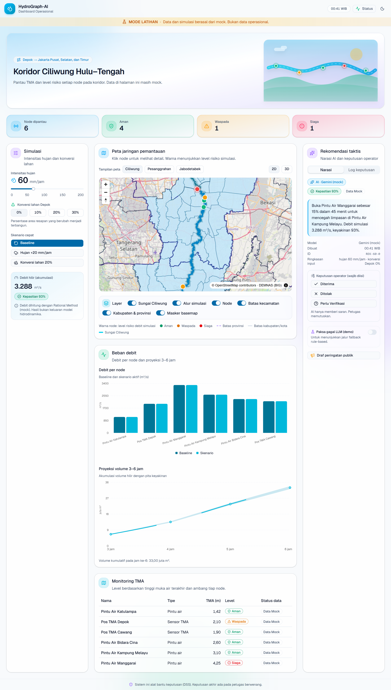

Satu layar memuat header dengan status dan waktu WIB, banner mode latihan, KPI risiko, panel simulasi, peta, panel rekomendasi, grafik, dan tabel monitoring.

### Panel simulasi

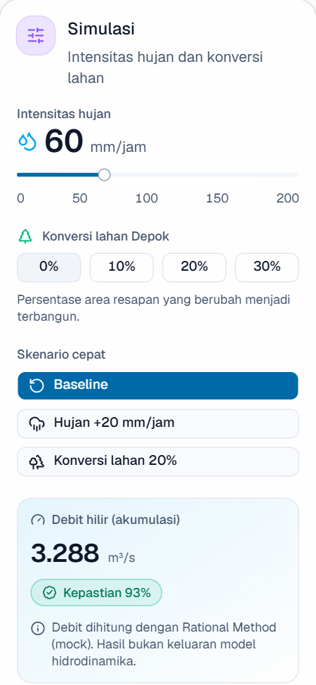

Slider intensitas hujan, konversi lahan Depok, tiga skenario cepat, serta debit hilir dan skor kepastian. Perubahan input memicu perhitungan ulang dengan debounce 300 ms.

### Peta jaringan (2D)

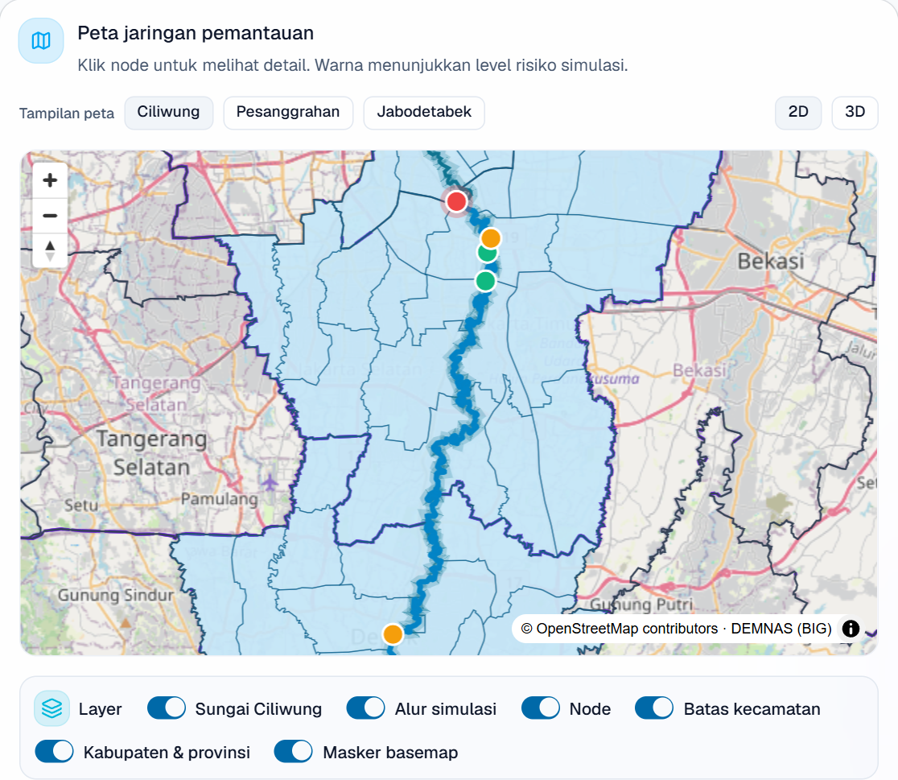

Ciliwung sebagai centerline, alur simulasi mengikuti sungai, node berwarna sesuai level risiko, batas kecamatan/kabupaten/provinsi, basemap OSM di luar cakupan, dan pilihan koridor Ciliwung/Pesanggrahan/Jabodetabek.

### Grafik debit dan proyeksi

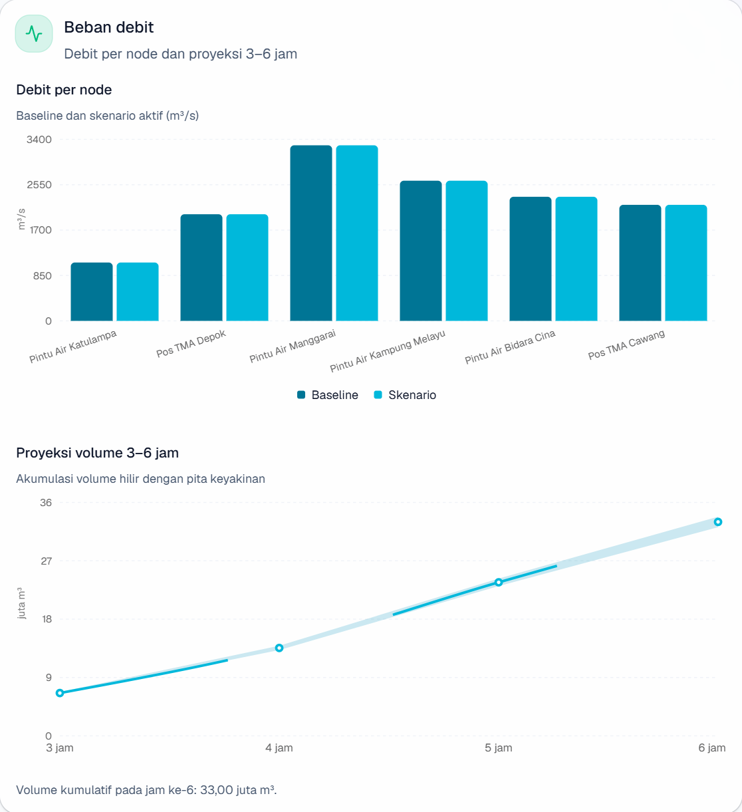

Debit per node (baseline vs skenario) dan proyeksi volume 3–6 jam dengan pita keyakinan.

### Rekomendasi taktis

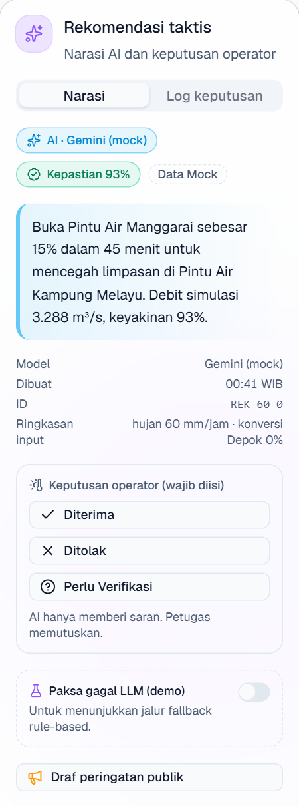

Narasi AI atau rule-based, badge sumber, skor kepastian, ringkasan input, tombol keputusan operator, dan toggle paksa gagal LLM.

### Log keputusan

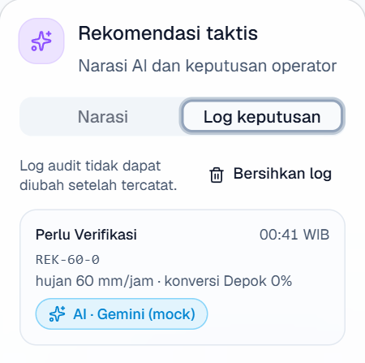

Setiap keputusan tercatat dengan waktu WIB, ID rekomendasi, sumber narasi, dan ringkasan input. Log tidak menimpa entri lama.

### Detail node

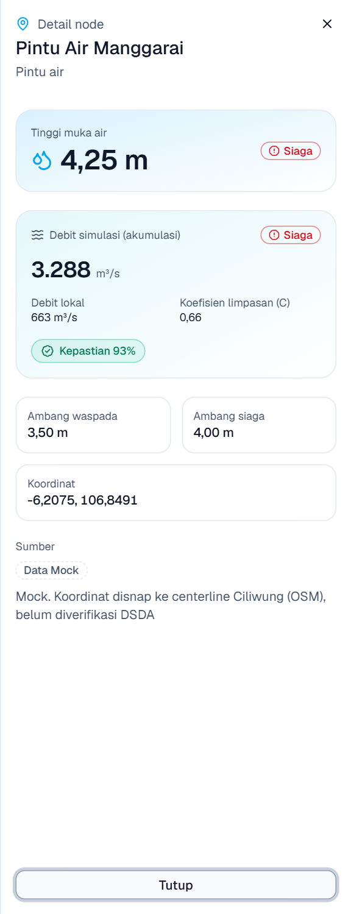

Panel samping berisi TMA, level risiko, debit simulasi, C-value, ambang, koordinat, dan status data.

### Panel peringatan publik

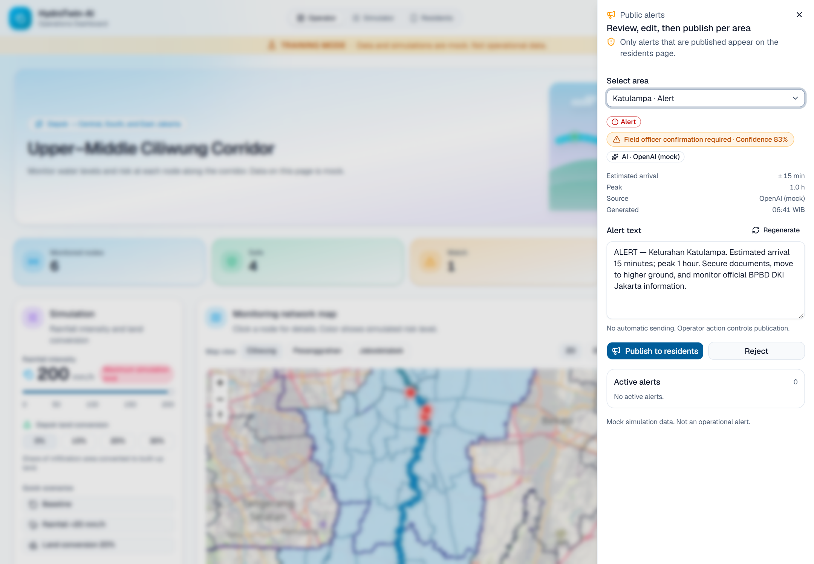

Panel peringatan F1–F2: kandidat per wilayah, pesan AI/fallback, sumber dan waktu generate, teks yang dapat disunting, aksi siarkan/tolak, dan daftar peringatan aktif yang dapat ditarik.

### Status data dan layanan

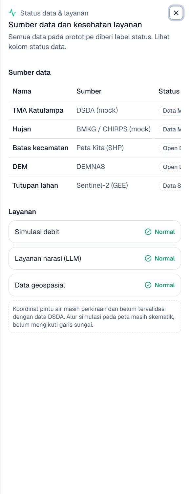

Sumber tiap layer, label open data/sintetis/mock, waktu pembaruan, status layanan, dan catatan validasi koordinat.

### Mode 3D

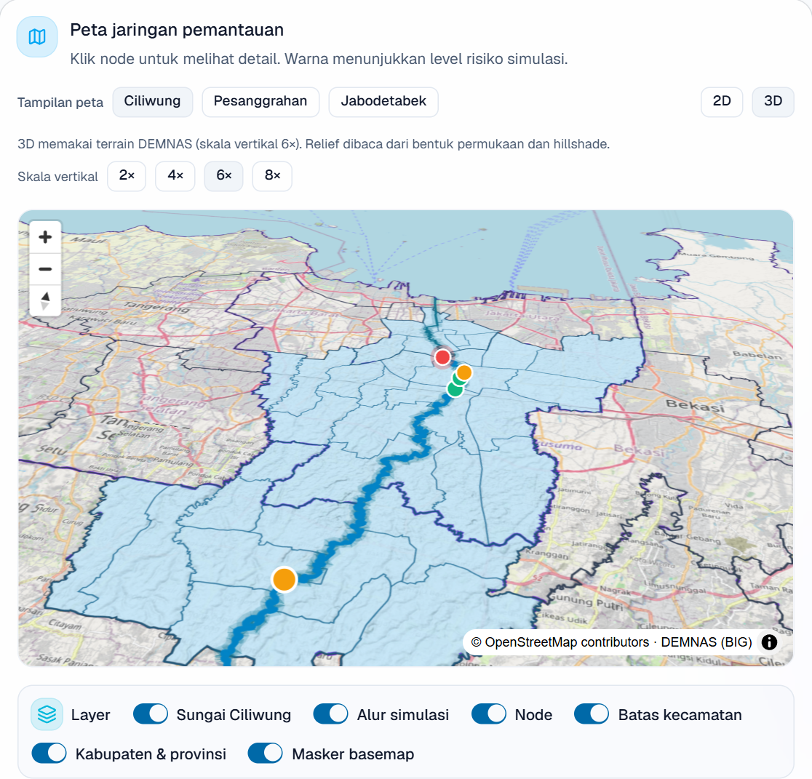

Terrain DEMNAS dengan skala vertikal yang dapat diatur (2× sampai 8×), hillshade dari DEM, dan alur Ciliwung yang mengikuti lembah.

## 5. Simulator dan PWA Warga

Dua surface ini melengkapi EWS. Status implementasi berbeda dari target rencana; lihat [`../plan/ews-simulator.md`](../plan/ews-simulator.md).

### Konsol perencana (`/rencana`) — Simulator


Status sekarang: parameter skenario dari registry, heatmap kedalaman per kelurahan dari 237 poligon BPS, dampak skenario (luas genangan, RW terdampak, puncak, keyakinan), grafik perbandingan opsi, interpretasi AI otomatis, dan Executive Brief on-demand dengan fallback serta ekspor Markdown. Angka dari model mock, bukan HEC-RAS.

Diambil dengan `apps/dashboard/scripts/screenshots-hydrotwin.mjs` (Puppeteer, 1440 px, mode terang).

### PWA warga (`/warga`) — EWS

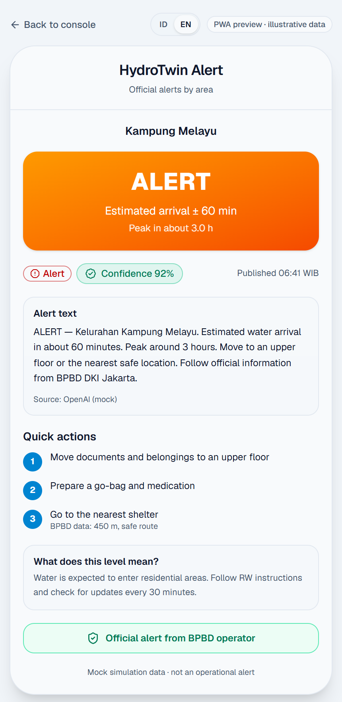

Status sekarang: tampilan mobile hanya membaca peringatan berstatus `disiarkan` per wilayah, dengan level, estimasi tiba, puncak, teks final hasil suntingan operator, langkah evakuasi, provenance AI/template, dan empty state resmi. GPS belum dipakai dan tidak dikirim ke server.

## 6. Dokumen Terkait

| Dokumen | Fungsi |
|---|---|
| `screen-inventory.md` | Daftar layar dan requirement |
| `wireframes.md` | Struktur layar (low fidelity) |
| `design-tokens.md` | Warna, tipografi, spacing |
| `interaction-spec.md` | Perilaku setiap kontrol |
| `demo-script.md` | Urutan demo |
| `a11y-checklist.md` | Checklist aksesibilitas |
| `usability-notes.md` | Catatan uji pengguna |
| `../analysis/requirements.md` | Requirement |

