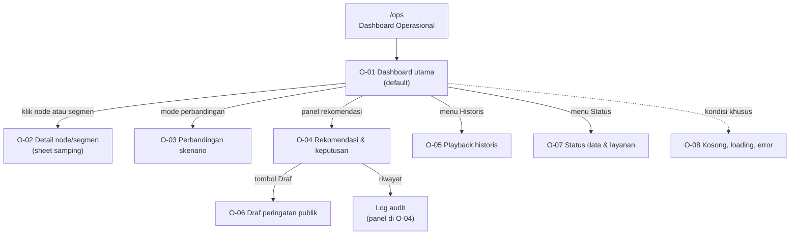

# UI Prototipe — Dashboard Operasional

Dokumen ini mendeskripsikan prototipe frontend dashboard yang interaktif. Kode prototipe ada di `apps/dashboard/` (belum dibuat).

| Item | Isi |
|---|---|
| Lingkup | Dashboard Operasional (`/ops`) |
| Tim | Tim SWE: Yovi Maulana Nugraha (UI/UX & mockup), Argo Nurcahyo (arsitektur & review) |
| Fidelity | Mockup visual lengkap, prototipe React interaktif |
| Stack | React 19, Vite, TypeScript, Tailwind CSS v4, shadcn/ui, MapLibre GL JS |
| Data | Mock dari SHP dan DEMNAS yang sudah dikonversi ke GeoJSON |
| Bahasa | Indonesia |

## 1. Site Map



Navigasi utama berada di header: **Pantau**, **Historis**, **Status**, dan **Log**. O-02 dan O-03 terbuka sebagai panel di atas O-01.

## 2. Struktur Layar

```
┌───────────────────────────────────────────────────────────────────────────┐
│ Header: logo · MODE LATIHAN · status layanan · waktu WIB · tema · menu   │
├──────────────┬──────────────────────────────────────┬─────────────────────┤
│ Panel kontrol│ PETA (2D/3D, node, edge, heatmap)    │ Panel rekomendasi   │
│ - hujan      │                                      │ - narasi AI/rule    │
│ - konversi   │                                      │ - confidence        │
│ - skenario   │                                      │ - keputusan         │
├──────────────┴──────────────────────────────────────┴─────────────────────┤
│ Grafik: debit per segmen | proyeksi 3–6 jam                             │
├───────────────────────────────────────────────────────────────────────────┤
│ Footer: disclaimer DSS · sumber data · versi prototipe                  │
└───────────────────────────────────────────────────────────────────────────┘
```

Detail ada di `wireframes.md`.

## 3. Prinsip Prototipe

1. **Satu layar utama.** Operator tidak harus berpindah halaman untuk simulasi.
2. **Hasil langsung terlihat.** Setiap perubahan input memperbarui peta, grafik, dan rekomendasi.
3. **Status selalu jelas.** Mode latihan, sumber narasi, dan confidence selalu terlihat.
4. **Keputusan tercatat.** Tidak ada aksi yang tidak meninggalkan jejak.
5. **Ramah kondisi darurat.** Warna, ikon, dan teks membawa informasi yang sama.

## 4. Dokumen Terkait

| Dokumen | Fungsi |
|---|---|
| `screen-inventory.md` | Daftar layar dan requirement |
| `wireframes.md` | Struktur layar (low fidelity) |
| `design-tokens.md` | Warna, tipografi, spacing |
| `interaction-spec.md` | Perilaku setiap kontrol |
| `demo-script.md` | Urutan demo |
| `a11y-checklist.md` | Checklist aksesibilitas |
| `usability-notes.md` | Catatan uji pengguna |
| `../analysis/requirements.md` | Requirement |
