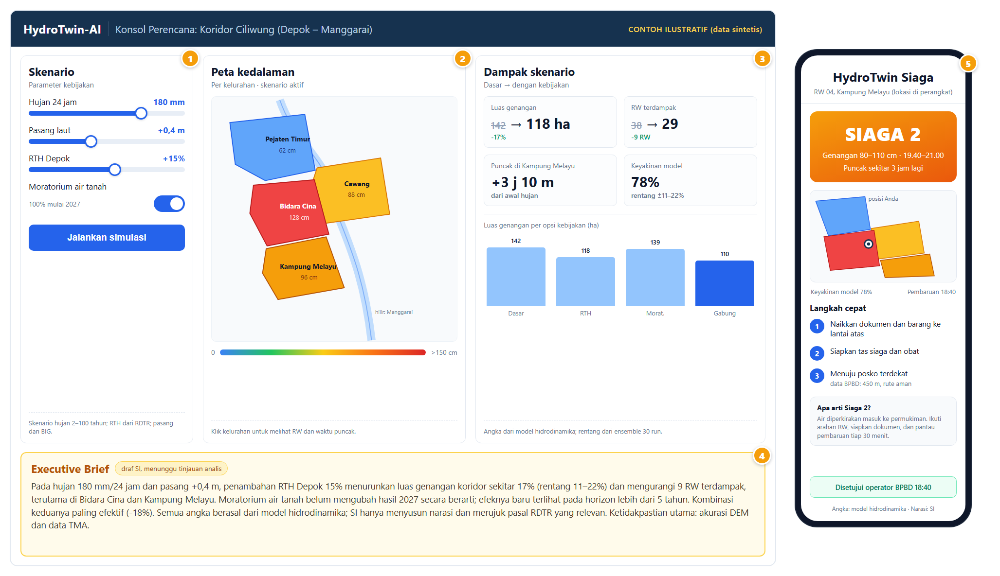

# Mockup HydroTwin-AI — Konsol Perencana dan PWA

Mockup untuk Gambar 2 proposal: keluaran simulasi yang dilihat perencana (kiri) dan peringatan yang dilihat warga (kanan). Semua angka ilustratif dan berasal dari data sintetis.



## Pemetaan callout

| No | Bagian | Isi |
|---|---|---|
| 1 | Skenario | Hujan 24 jam, pasang laut, RTH Depok, moratorium air tanah |
| 2 | Peta kedalaman | Empat kelurahan inti, kedalaman per kelurahan, legenda 0–>150 cm |
| 3 | Dampak skenario | Luas genangan, RW terdampak, waktu puncak, keyakinan model, grafik opsi |
| 4 | Executive Brief | Draf narasi SI, menunggu tinjauan analis; angka dari model |
| 5 | PWA warga | Level Siaga 2, kisaran kedalaman, posisi di perangkat, langkah evakuasi, persetujuan BPBD |

## Berkas

| Berkas | Fungsi |
|---|---|
| `mockup-konsol-pwa.html` | Sumber mockup, tanpa dependensi eksternal |
| `mockup-konsol-pwa.png` | Ekspor 2055 × 1185 px untuk proposal |

## Regenerasi PNG

```powershell
& 'C:\Program Files (x86)\Microsoft\Edge\Application\msedge.exe' `
  --headless=new --disable-gpu --hide-scrollbars `
  --window-size=2055,1185 --virtual-time-budget=4000 `
  --screenshot="docs\ui-prototype\hydrotwin\mockup-konsol-pwa.png" `
  "file:///D:/code/argonurcahyo/si_bridges/docs/ui-prototype/hydrotwin/mockup-konsol-pwa.html"
```

Ubah teks atau warna langsung di HTML, lalu jalankan perintah di atas. Jangan mengubah ukuran `.canvas` tanpa menyesuaikan `--window-size`.
